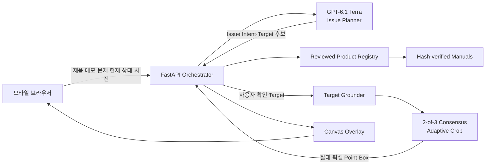
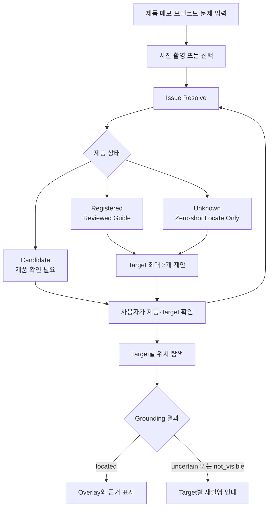
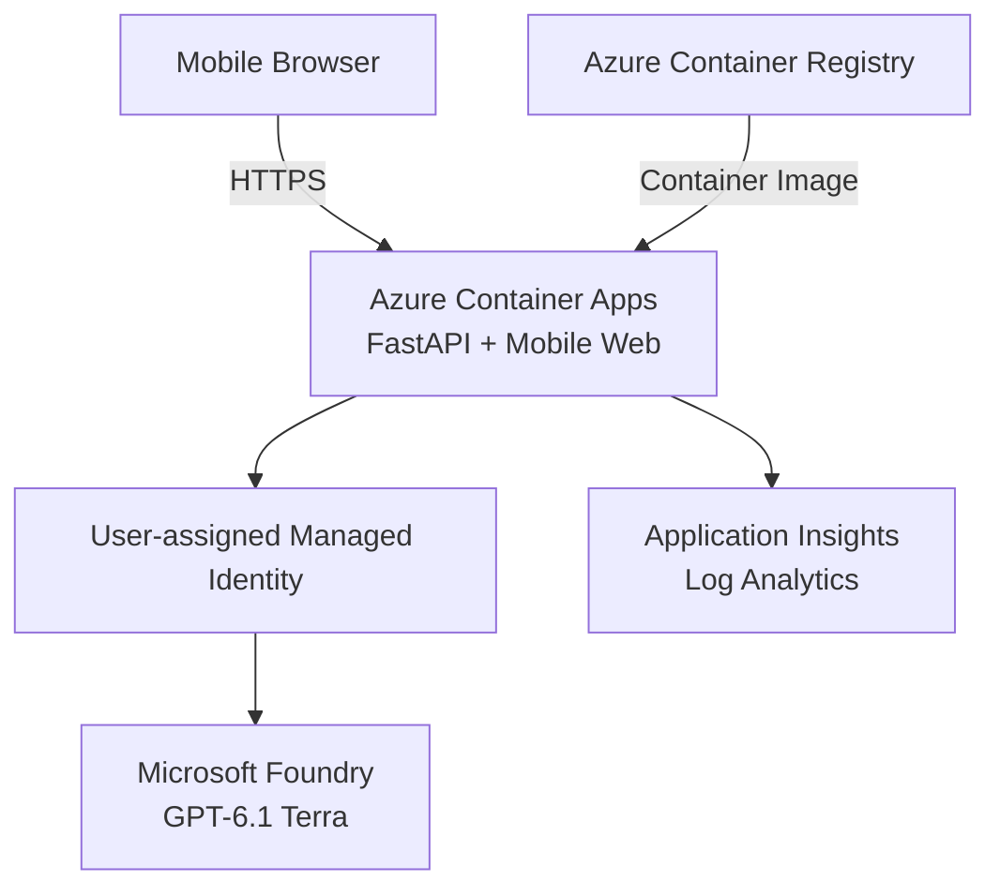

## 모바일 카메라 앱

[카메라로 Visual Product Guide 테스트하기](https://azapi5ovedhtoyg74w.calmcoast-1ab8f441.swedencentral.azurecontainerapps.io/demo)

별도 접근코드 없이 모바일 브라우저에서 링크를 열어 바로 테스트할 수 있다.

## 프로젝트 개요

사용자가 제품 메모, 모델코드, 현재 상태와 해결할 문제를 입력하고 카메라로
제품을 촬영하면 Agent가 찾을 대상을 제안하고 사진 위에 Overlay로 표시하는
모바일 브라우저 PoC다.

## 현재 상태

등록 제품과 미등록 제품을 함께 지원하는 Hybrid 구조를 사용한다.

* 등록 제품은 정확한 모델코드, 공식 설명서 해시와 페이지 근거를 검증한 뒤
  reviewed guide를 제공한다.
* 제품 후보는 사용자가 정확한 모델을 확인할 때까지 공식 절차를 제공하지
  않는다.
* 미등록 제품은 보이는 대상의 zero-shot 위치만 제공하고 모델 라벨이나
  공식 설명서를 요청한다.

첫 등록 제품은 삼성 Bespoke AI 콤보 25/18kg 다크스틸
`WD80H25BHS`다.

현재 구현은 다음 원칙을 따른다.

* 사용자의 자유형 문제를 최대 3개의 독립 target으로 분리한다.
* 사용자가 target을 삭제하거나 표시 이름을 바꾸고 새 target을 추가할 수
  있다.
* 정확한 제품코드와 검수된 설명서가 일치해야 공식 가이드를 사용한다.
* target마다 GPT-6.1 Terra 제안 세 개 중 두 개 이상이 공간적으로
  일치해야 위치를 승인한다.
* 합의하지 못한 target만 검수된 상대 위치로 crop해 한 번 재분석한다.
* 좌표는 전송 이미지 기준 절대 픽셀로 반환하고 crop 좌표는 서버가
  원본 좌표로 변환한다.
* `located`, `not_visible`, `uncertain`을 target마다 반환해 부분 성공을
  보존한다.
* P3의 SAM 3.1과 비디오 추적은 P0~P2 평가 이후로 보류한다.

## 아키텍처



각 구성 요소의 책임은 분리돼 있다.

| 구성 요소 | 책임 |
|---|---|
| 모바일 브라우저 | 카메라 촬영, 자유형 문제 입력, 제품·target 확인, Overlay 렌더링 |
| FastAPI | 요청 검증, workflow 조정, 제품·단계 권한 검사, 보호된 `/v1` API 인증 |
| GPT-6.1 Terra Issue Planner | 문제 의도와 최대 3개의 atomic target 제안 |
| Reviewed Registry | 정확한 모델코드, component alias, issue-to-guide, 상태별 step 관리 |
| Manual Asset Provider | 공식 설명서 SHA-256과 적용 모델 검증 |
| Target Grounder | target별 독립 위치 제안, consensus, adaptive crop |
| Azure Container Apps | 공개 HTTPS API와 모바일 웹 호스팅 |
| Azure Container Registry | 재현 가능한 container image build와 저장 |
| Managed Identity | Container App에서 Foundry와 Azure 리소스 접근 |

GPT는 제품이나 설명서의 적용 가능성을 승인하지 않는다. 제품과 가이드
권한은 registry와 서버가 결정하며, GPT는 문제 해석과 현재 사진의 위치
후보 생성에만 사용한다.

## 사용자 Workflow



### 1단계: Issue Resolve

`POST /v1/issues/resolve`는 자연어 문제를 분석하지만 좌표를 생성하지 않는다.

1. 사용자의 제품 메모, 모델코드, 문제와 현재 상태를 받는다.
2. 문제를 최대 3개의 독립 target으로 분리한다.
3. exact model, 제품 후보 또는 미등록 제품 상태를 결정한다.
4. 등록 제품의 target을 reviewed component alias에 매핑한다.
5. 사용자가 확인할 제품 후보, target과 지원 모드를 반환한다.

제품 상태별 동작은 다음과 같다.

| 제품 상태 | 지원 모드 | 동작 |
|---|---|---|
| `registered` | `reviewed_guide` | exact model과 공식 설명서를 검증하고 근거 있는 guide 후보 제공 |
| `candidate` | `zero_shot_locate_only` | 사용자가 exact model을 확인하기 전까지 공식 절차 차단 |
| `unknown` | `zero_shot_locate_only` | 보이는 target 위치만 탐색하고 모델 라벨·설명서 요청 |

### 2단계: Issue Ground

`POST /v1/issues/ground`는 사용자가 확인한 target을 사진에서 독립적으로
찾는다.

```text
Target
  -> 전체 이미지에서 GPT 제안 3회
  -> 두 개 이상 공간 합의
  -> located이면 절대 픽셀 Point·Box 반환
  -> uncertain이면 검수된 상대 영역을 원본 픽셀로 Crop
  -> Crop에서 한 번만 3회 재분석
  -> 원본 이미지 좌표로 변환
  -> 실패하면 Target별 재촬영 안내
```

한 target의 provider 오류나 위치 실패가 다른 target의 성공 결과를
지우지 않는다. 다만 Foundry 장애는 시각적 `uncertain`으로 숨기지 않고
HTTP 503과 이미 완료된 target 결과로 반환한다.

### 권한과 신뢰 경계

* Issue Resolution 전체를 HMAC으로 서명해 client가 canonical name,
  alias, 상대 위치, registry ID와 설명서 근거를 변조하지 못하게 한다.
* target 이름 수정은 화면 표시명만 변경한다.
* 새 target은 client가 metadata를 만들지 않고 Issue Planner로 다시
  분석한다.
* reviewed instruction은 exact model, manual hash, issue intent, 현재 상태,
  guide와 step이 모두 일치할 때만 반환한다.
* zero-shot target에는 공식 조작 instruction을 표시하지 않는다.

## 배포 구조



현재 배포는 Sweden Central의 Container Apps를 사용한다. P3에서 SAM 3.1
GPU inference를 추가할 때는 Sweden Central에 고정하지 않고 quota가 있는
Azure region을 선택한다.

## 문서

* [재구축 설계](docs/superpowers/specs/2026-11-01-visual-guide-rebuild-design.md)
* [구현 계획](docs/superpowers/plans/2026-11-01-visual-guide-rebuild.md)
* [WD80H25BHS P0-P2 설계](docs/superpowers/specs/2026-11-02-wd80h25bhs-p0-p2-design.md)
* [WD80H25BHS P0-P2 구현 계획](docs/superpowers/plans/2026-11-02-wd80h25bhs-p0-p2.md)
* [Hybrid issue 설계](docs/superpowers/specs/2026-11-02-hybrid-issue-guidance-design.md)
* [Hybrid issue 구현 계획](docs/superpowers/plans/2026-11-02-hybrid-issue-guidance.md)

## WD80H25BHS 설명서 근거

* 18쪽은 조작부, 일반·선택 세제함과 세제함 전면 덮개를 제품 구성으로
  식별한다.
* 22쪽은 세제함 전면 덮개가 제품 전면 하단에 있으며 덮개 상단 가운데를
  눌러 연다고 설명한다.
* 27쪽은 조작부가 제품 전면 상단 가운데에 있다고 설명한다.

따라서 제품 상단 오른쪽 사각 덮개는 세제 투입구로 안내하지 않는다.

## 실사 평가

세 개의 제공 이미지에서 두 target을 각각 세 번 평가했다.

| Target | Located | Point-in-box | 평균 IoU | 최소 IoU | False not-visible |
|---|---:|---:|---:|---:|---:|
| 세제함 전면 덮개 | 9/9 | 9/9 | 0.781 | 0.636 | 0 |
| 조작부 | 9/9 | 9/9 | 0.684 | 0.636 | 0 |

요청 단위 지연은 p50 20.858초, 최대 26.111초였다. 세 catalog 이미지에서는
전체 사진 합의가 성립해 adaptive crop 재시도는 발생하지 않았다.

## Hybrid issue 평가

GPT-6.1 Terra로 등록 exact model, 사용자식 표현, 모델코드 없는 후보,
미등록 제품, 잘못된 모델코드와 4-target 제한 사례를 평가했다.

* 6/6 사례에서 registered, candidate, unknown 제품 상태가 기대와 일치했다.
* 6/6 사례에서 reviewed 또는 zero-shot 지원 모드가 기대와 일치했다.
* Exact model과 사용자식 표현 사례는 intent와 target precision/recall이
  모두 1.0이었다.
* 미등록 제품은 official guide 없이 `zero_shot_locate_only`로 유지됐다.
* 네 대상 요청은 세 대상으로 제한되고 truncation이 명시됐다.
* Issue resolution 지연은 최신 prompt 기준 등록 사용자식 표현에서
  8.337초였다.

## 배포된 모바일 PoC

페이지는 자유형 문제 입력, 후면 카메라 촬영, 제품 후보 확인, target 편집과
다중 Overlay를 제공한다. 사진은 8MP 이하로 브라우저에서 축소되고 문제
분석과 위치 요청에 GPT-6.1 Terra로 전달된다. 등록 제품의 근거가 없는
zero-shot 결과는 공식 조작 절차가 아니다.
