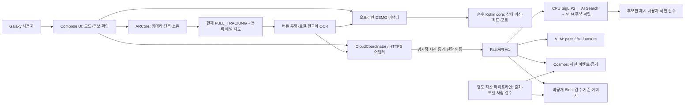
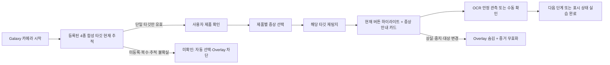
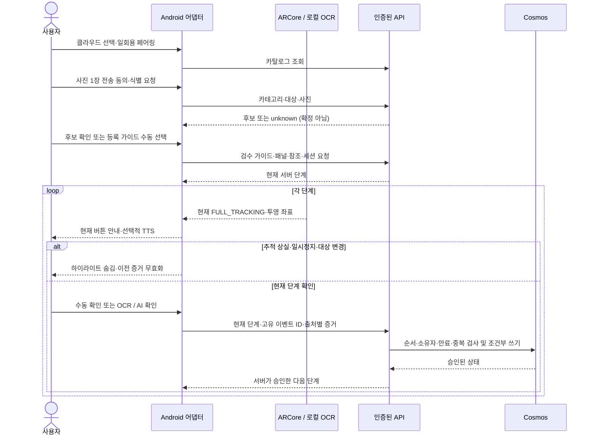

## Mock-up 테스트 앱 설치 및 바로 접속

| 용도 | 설치 및 접속 링크 |
|------|------------------|
| Galaxy 설치용 APK | [최종 테스트 APK 다운로드](https://github.com/daeungo1/visual-product-recognition/releases/latest/download/app-android-debug.apk) |
| 배포 정보 및 무결성 | [Mock-up Release](https://github.com/daeungo1/visual-product-recognition/releases/latest), [APK SHA-256](https://github.com/daeungo1/visual-product-recognition/releases/latest/download/app-android-debug.apk.sha256) |
| PC 제품별 시나리오·타깃 | [에어컨·세탁기·냉장고·모니터 Overlay 목업](https://daeungo1.github.io/visual-product-recognition/) |
| 설치·페어링·시험 순서 | [Galaxy 테스트 안내](./docs/galaxy-test.md) |
| HTTPS API | [liveness](https://ca-svg-dev-4ca0.whiterock-2d71d661.japaneast.azurecontainerapps.io/healthz), [readiness](https://ca-svg-dev-4ca0.whiterock-2d71d661.japaneast.azurecontainerapps.io/readyz) |
| 공개 소스 | [daeungo1/visual-product-recognition](https://github.com/daeungo1/visual-product-recognition) |

> [!WARNING]
> 합성 제품 패널용 개발 서명 APK이며 실제 삼성 제품 지원 앱이 아니다.
> APK 컴파일과 자동 테스트는 Galaxy 설치·카메라·AR 정합 검증을 의미하지 않는다.
> 웹 주소는 PC에 띄울 타깃이며 Android 앱의 웹 버전이 아니다.
> API 주소는 브라우저용 앱 화면이 아니며, 클라우드 이용에는 별도 단말 페어링이 필요하다.

2026-10-26 공개 APK를 다시 내려받아 SHA-256 일치를 확인했고,
공개 웹 목업의 4종 진행·추적 상실·미등록 차단 37개 브라우저 검사를 통과했다.
자동 테스트 및 APK 무결성은 [검증 기록](./docs/verification.md)에 정리했다.

1. PC에서 [제품 이슈 Overlay 목업](https://daeungo1.github.io/visual-product-recognition/)을 열고
   에어컨·세탁기·냉장고·모니터 중 한 합성 제품을 선택한다.
2. Android 8.0 이상 Galaxy에 APK를 설치한다. 카메라 추적은
   [ARCore 지원 기기](https://developers.google.com/ar/devices)와 Google Play Services for AR가 필요하다.
3. 앱의 `카메라로 제품 이슈 DEMO`에서 PC 타깃 전체를 비춘다.
   감지된 합성 제품을 사용자가 확인하고 해당 증상의 `Overlay 안내 시작`을 누른다.
   계정, 페어링 및 사진 업로드 없이 실행한다.
4. 현재 FULL_TRACKING에서만 버튼 하이라이트와 증상 안내 카드가 카메라에 표시된다.
   PC의 해당 영역을 눌러 표시 상태를 바꾸고 OCR 또는 수동 확인으로 진행한다.
   추적 상실·다른 제품·앱 중지 시 이전 안내를 숨긴다.
5. 실제 식별·AI 확인·세션 저장 시험은 `실제 HTTPS 클라우드 연결`을 선택하고
   운영자 발급 일회용 코드로 페어링한다. 공개 README에는 코드를 제공하지 않는다.

## 현재 구현

목표 고객 시나리오는 “삼성 제품을 비춤 → 모델 확인 → 증상 선택 →
제품 위에 해결 절차 Overlay → 결과 확인 또는 공식 지원 연결”이다.
현재 구현은 이 흐름을 아래 네 가지 독립 합성 패널로 시험하는 목업이다.

| 제품형 DEMO | 증상 | 합성 표시 확인 순서 |
|-------------|------|---------------------|
| 에어컨 | 시원한 바람이 나오지 않아요 | POWER ON → MODE COOL → TEMP 24 |
| 세탁기 | 세탁이 시작되지 않아요 | POWER ON → DOOR CLOSED → READY YES |
| 냉장고 | 냉기가 약하게 느껴져요 | POWER ON → MODE COOL → TEMP 3 |
| 모니터 | 화면에 신호가 없어요 | POWER ON → INPUT HDMI → SIGNAL OK |

위 상태와 숫자는 가상 실습값이지 삼성 공식 조작 절차나 실제 권장 설정이 아니다.
표시 일치는 실제 냉방·냉각·문 잠금·세탁 운전·영상 복구를 입증하지 않는다.
브라우저의 `표시 상태 확인`도 OCR·VLM 판정이 아닌 PC 시뮬레이션 비교다.
실제품 모델·검수 패널이 없으면 “미등록/모델 확인 필요”로 남기고 임의 Overlay를 표시하지 않는다.

Galaxy에서 카메라로 등록된 대상을 비추고 버튼 안내와 단계 진행을 시험하는
Kotlin/Compose 앱이다. 오프라인 DEMO와 실제 HTTPS 클라우드 모드를 명시적으로 구분한다.
클라우드 오류를 오프라인 성공이나 임의 AI 결과로 대체하지 않는다.

실제 Azure Container Apps, CPU SigLIP2, AI Search, Azure OpenAI,
Cosmos DB와 비공개 Blob을 구성했다. API는 관리 ID로 Azure에 접근한다.
Cosmos와 Blob은 공용 접근을 차단하고 VNet의 Private Endpoint로 연결한다.
공식 ARCore 1.48 도구에서 기존 리모컨은 100점,
새 제품형 참조는 에어컨100·세탁기90·냉장고100·모니터100점으로
권장 최소 75점을 통과했다. SDK 참조 품질이며 실기기 정합 성능은 아니다.

현재 Azure에 등록된 자산은 직접 제작한 기존 합성 리모컨과
`POWER ON → MODE COOL → TEMP 24` 가이드다.
새 4종 제품형 패널은 Android 오프라인·웹 데모에 포함했다.
클라우드 카탈로그에 자동 게시하거나 기존 Azure 서비스를 재배포하지 않았다.
삼성 실제 모델, 공식 가이드 및 실제품 사진을 임의로 등록하지 않았다.
실제 삼성 제품의 식별 정확도나 버튼 정합, 사용자 완주율을 입증한 결과는 아니다.
연결된 Galaxy가 없어 카메라, OCR, TTS 및 실제 정합의 실기기 시험은 남아 있다.

## 바로 시험하기

* [설치용 APK와 체크섬](https://github.com/daeungo1/visual-product-recognition/releases/latest)
* [4종 제품 이슈·Overlay 웹 목업](https://daeungo1.github.io/visual-product-recognition/)
* [기존 HTTPS 시나리오용 합성 리모컨](https://daeungo1.github.io/visual-product-recognition/demo-target.html)
* [오프라인 PC 타깃 소스](./assets/demo-target.html), [같은 폴더에 둘 PNG](./assets/demo-target.png)
* [Galaxy 시험 순서 및 페어링](./docs/galaxy-test.md)
* [검증 결과와 알려진 제한](./docs/verification.md)
* [실제 Azure 구성과 재배포](./docs/azure-architecture.md)

API 원점:

```text
https://ca-svg-dev-4ca0.whiterock-2d71d661.japaneast.azurecontainerapps.io
```

아래는 기존 클라우드 등록 리모컨의 실제 API 시험이다. 새 4종 합성 패널은
맨 위의 카메라 기반 오프라인 제품 이슈 DEMO에서 시험한다.

1. PC에서 기존 합성 리모컨 타깃을 연다. 오프라인 HTML 사용 시 같은 폴더의 PNG도 필요하다.
2. 지원되는 Galaxy에 APK를 설치하고 `실제 HTTPS 클라우드 연결`을 선택한다.
3. 운영자의 일회용 코드를 입력하고 `페어링 · 연결`을 누른다.
   코드와 토큰은 APK에 포함하지 않는다.
4. `에어컨`, `리모컨`을 선택하고 사진 전송 동의 후
   `사진 1장 · 실제 식별`을 누른다.
5. 반환된 DEMO 후보를 사용자가 확인하고 가이드를 선택한다.
6. 타깃 전체가 추적되면 현재 버튼 위에 안내가 나타난다.
   PC 타깃의 버튼을 눌러 상태를 바꾸고 OCR, AI 또는 수동 확인을 시험한다.

사진 전송이 필요 없는 시험은 `카메라로 제품 이슈 DEMO` 또는
`기존 리모컨 · 오프라인 DEMO`를 선택한다.
이 모드의 진행은 메모리 전용이다. 클라우드 모드는 서버 승인과 Cosmos 세션을 사용하며
저장 단말 및 세션 복원 기능을 제공한다. 단말 토큰 만료 후에는 새 코드가 필요하다.

## 코드 구조

| 위치 | 책임 |
|------|------|
| [core](./core/) | 프레임워크 없는 Kotlin 도메인, 상태 머신, 좌표 및 포트 |
| [app-android](./app-android/) | Compose, ARCore, 한국어 ML Kit OCR, TTS, 암호화 단말 등록과 HTTPS 어댑터 |
| [server](./server/) | FastAPI, 실제 Azure 어댑터, 인증, 후보 검색, 단계 판정과 조건부 세션 쓰기 |
| [pipeline](./pipeline/) | 자체 자산 생성, 검수 자산 등록, 검색 활성화와 비공개 페어링 발급 |
| [assets](./assets/) | 4종 공유 시나리오 카탈로그, 합성 타깃·패널 지도·대화형 HTML |
| [infra](./infra/) | 기본 서비스, 추가 사설 네트워크 및 앱 단독 배포 Bicep |
| [eval](./eval/) | 라벨 기반 식별, 정합, 완주 지표와 부족한 데이터 처리 |

ARCore만 카메라를 소유한다. CameraX가 별도 카메라를 열지 않는다.
등록 이미지와 카메라가 모두 현재 추적 중일 때만 하이라이트와 OCR을 사용한다.
마지막 알려진 자세, 가림, 추적 상실 및 앱 중지 시 안내를 숨긴다.
OCR은 표시 상태를 확인할 뿐 물리 버튼을 눌렀거나 부품을 장착했다는 증거는 아니다.

## 아키텍처

읽기 순서는 `Galaxy UI → 외곽 어댑터 → 순수 core`다.
카메라는 ARCore가 단독 소유하고 현재 추적 중인 등록 타깃 좌표만 투영한다.
오프라인은 로컬 상태 머신, 클라우드는 인증된 API와 Cosmos 승인 상태를 사용한다.



* `core`는 Android, ARCore, ML Kit, HTTP 및 Azure SDK를 참조하지 않는다.
* 제품 이슈 DEMO는 [공유 카탈로그](./assets/scenarios/catalog.json)를
  Android와 웹이 함께 읽는다. 4종 기준 이미지를 ARCore에 등록해 탐지하고
  하나의 타깃이 현재 추적될 때만 제품 확인 후보를 표시한다.
  복수 대상·추적 상실은 자동 선택하지 않는다. 수동 선택은 인식 성공과 구분한다.
* 오프라인 모드는 로컬 상태 머신과 메모리 진행을 사용한다.
  클라우드 모드는 HTTPS 어댑터에서 서버가 승인한 단계만 표시한다.
* Cosmos와 Blob은 Private Endpoint를 사용한다. Galaxy의 API ingress는 공용 HTTPS다.
  Search와 OpenAI까지 사설 연결이라고 표시하지 않는다.
* GitHub Pages는 명시적으로 선택한 합성 HTML·PNG·카탈로그만 제공한다.
  카메라 업로드·인증·API를 호스팅하지 않는다.
* [실제 Azure 토폴로지](./docs/azure-architecture.md)와
  [API 계약](./docs/cloud-api-contract.md)에 네트워크·권한·요청 형식이 있다.

## 사용자 및 증거 워크플로

제품 이슈 DEMO의 첫 흐름은 다음과 같다. 실제 HTTPS 식별은 아래 별도 흐름이다.

1. 카메라로 등록 합성 제품 하나를 탐지하고 사용자가 제품·증상을 확인한다.
2. 해당 타깃이 현재 추적 중일 때만 버튼 하이라이트와 증상 안내를 표시한다.
3. 안정 OCR 또는 수동 확인으로 다음 단계에 진행하며 완료 출처를 구분한다.
4. 추적 상실·앱 중지·대상 변경은 안내와 이전 증거를 무효화한다.
5. 클라우드는 일회용 페어링·사진 동의·후보 확인을 추가하고, 현재 단계의
   유효 증거·고유 이벤트 ID를 검증한 뒤 서버가 진행을 승인한다.





AI 확인은 별도 `/verify` 요청으로 현재 단계용 30초 증거를 발급한 뒤
진행 이벤트에서 소비한다. `fail`, `unsure`, `unknown`, 오류는 성공이 아니다.
같은 이벤트 재시도는 원래 응답을 반환하며 실제 최신 세션을 다시 읽어
화면이 과거 단계로 돌아가지 않도록 한다.
수동 확인과 자동 확인은 출처를 분리한다.
사진은 버튼을 명시적으로 누를 때만 보내며, 연속 카메라 프레임을 서버에 업로드하지 않는다.

## 고객 요구사항 대비 구현과 부족한 근거

제공된 별도 고객 승인 PRD는 없다. 아래 항목은 직접 요청한
“삼성 에어컨·세탁기·냉장고·모니터를 비추면 이슈 해결 Overlay”와
[기존 PoC 범위](./docs/poc-plan.md), [리서치 요구사항](./docs/research-review.md)을
기준으로 대조했다. 구현 여부와 실제 고객 환경의 성능 입증은 별개다.

| 요구 | 현재 구현·검증 | 판정 또는 남은 작업 |
|------|----------------|---------------------|
| 제품을 비추면 증상별 Overlay | 에어컨·세탁기·냉장고·모니터 합성 타깃 탐지·확인·증상·추적 안내 | 오프라인 목업 구현, 일반 삼성 실물 범용 인식 아님 |
| Galaxy 설치형 안내 | Compose·ARCore·OCR·TTS, APK와 lint | 컴파일 검증, 실기기 미검증 |
| 제품 식별·후보 확인 | SigLIP2·Search·VLM, unknown과 사용자 확인 구분 | 합성 자산만 확인, 실제품 정확도 미측정 |
| 움직이는 대상 버튼 정합 | 현재 FULL_TRACKING에서만 지도 좌표 투영 | 추적 상실 차단 구현, Galaxy p95 오차 미측정 |
| 단계별 OCR·AI·수동 확인 | 안정 OCR, pass/fail/unsure, 출처 분리 | 상태·계약 자동 테스트, 실제 OCR 정확도 미측정 |
| 중복·지연 응답·복원 | 이벤트 ID, 단계별 증거, 암호화 단말 저장, Cosmos | 자동 테스트, 과거 실제 Azure 검증과 현재 health 구분 |
| 사진 동의·자격 증명 보호 | 명시적 1장 전송, APK에 키 없음, 단말 인증 | 고객 운영 전 보존·동의·접근 정책 확정 필요 |
| 실제 모델·공식 가이드 | 출처·적용 모델·사람 검수 등록 경로 | 실제품 자산 없음, 삼성 제품 지원 미완료 |
| TV 화면과 리모컨 전환 | 대상 종류 선택과 추적 무효화 경계 | 검수된 TV 다중 대상 가이드·실증 없음 |
| 필터 작업·SAM 3·Content Understanding | 현재 런타임에 포함하지 않음 | 별도 자산·안전 검수·범위 승인 필요 |
| 초심자 무도움 완주 | 독립 라벨 평가 러너 | 초심자 5명 이상 시험 미실시 |
| 외부 테스터 접근 | 공개 Release APK·체크섬, Pages PC 타깃 | 개발용 목업, 스토어·운영 서비스 아님 |

실제 모델 식별 Top-1 90%, Top-3 98%, 버튼 정합 p95 25% 이내,
초심자 5명 중 4명 무도움 완주는 [제안 목표](./docs/research-review.md#제안하는-수용-기준)이며
달성 수치가 아니다. 따라서 현재 결과는 고객 요구사항의 합성 목업 검증이고,
실제 삼성 제품용 PoC의 최종 수용 완료는 아니다.

2026-10-26 개선에서는 API가 허용하는 500자 제목·128단계 가이드를
Android가 거절하던 문제와, API 한도 256자를 넘는 페어링 코드를
Android가 전송하던 문제를 회귀 테스트로 재현하고 어댑터에서 수정했다.
코어 계약과 기존 Azure 인프라는 변경하지 않았다.

## 빌드 및 자동 검증

JDK 17, Android SDK 35, Build Tools 35.0.0이 필요하다.
Gradle Wrapper 8.11.1, AGP 8.9.2, Kotlin 2.1.20을 사용한다.
이 환경의 도구는 무시된 프로젝트 전용 폴더에 설치했으며 시스템 JDK를 변경하지 않았다.

자체 타깃 재생성은 기존 서버의 Pillow 환경을 사용한다.
공식 SDK 도구가 설치되어 있다면 점수 검증을 함께 실행한다.

```powershell
uv sync --project .\server --python 3.11
.\pipeline\Generate-DemoTarget.ps1 `
  -ArcoreImgPath (Join-Path $PWD '.tools\arcore-validation-1.48.0\arcoreimg.exe')
```

4종 제품형 패널은 동일한 시나리오 카탈로그에서 다시 만든다.
검사 도구를 지정하면 각 참조의 75점 미만을 실패 처리한다.
최종 참조 점수는 에어컨 100, 세탁기 90, 냉장고 100, 모니터 100이며 실제 정합 정확도가 아니다.

```powershell
.\server\.venv\Scripts\python.exe .\pipeline\generate_scenario_targets.py `
  --arcoreimg .\.tools\arcore-validation-1.48.0\arcoreimg.exe
```

개선한 참조는 콘텐츠 해시가 붙은 새 클라우드 ID로 등록한다.
기존 게시 자산은 덮어쓰지 않는다.
현재 권장 가이드는 `demo-aircon-0097d99781cc`다.

```powershell
$env:JAVA_HOME = Join-Path $PWD '.tools\jdk\jdk-17.0.20.1+1'
$env:PATH = "$env:JAVA_HOME\bin;$env:PATH"
$env:ANDROID_HOME = Join-Path $PWD '.tools\android-sdk'
$env:ANDROID_SDK_ROOT = $env:ANDROID_HOME
$env:GRADLE_USER_HOME = Join-Path $PWD '.tools\gradle-cache'
.\gradlew.bat --no-daemon --max-workers=2 --console=plain `
  '-Pkotlin.compiler.execution.strategy=in-process' `
  '-PVISUAL_GUIDE_API_BASE_URL=https://ca-svg-dev-4ca0.whiterock-2d71d661.japaneast.azurecontainerapps.io' `
  :core:jvmTest :app-android:testDebugUnitTest :app-android:assembleDebug :app-android:lintDebug

Set-Location .\server
uv sync --python 3.11 --extra cloud
uv run --no-sync pytest tests
uv run --no-sync ruff check src tests
uv run --no-sync pytest ..\eval\tests
```

연결 모드의 기본 URL은 공개 주소일 뿐 자격 증명이 아니다.
미설정 빌드는 앱에서 HTTPS 원점을 입력할 수 있다.
기업 네트워크에서는 승인된 패키지 미러를 사용하며 TLS 검증을 끄지 않는다.
실제 임베딩 모델은 ACR의 Linux 이미지 빌드 중 로드하고
768차원 유한 정규화 벡터 생성을 검사한다. 로컬 단위 테스트의 가짜 어댑터로
실제 모델 동작을 검증했다고 처리하지 않는다.

### 공개 저장소의 반복 검증과 배포

[검증 workflow](./.github/workflows/validate.yml)는 core·Android·API·평가 테스트,
Ruff, APK 빌드와 lint를 실행하고 결과 및 APK를 Actions artifact로 남긴다.
[Pages workflow](./.github/workflows/pages.yml)는 허용 목록의 합성 HTML·PNG·카탈로그만 게시한다.
어느 workflow도 Azure 자격 증명을 사용하거나 유료 리소스를 배포하지 않는다.

Release APK는 검증한 빌드를 게시한다. Actions의 새 debug APK는 작업마다
개발 서명이 달라질 수 있으므로 기존 설치본과 서명이 다르면 덮어쓸 수 없다.
삭제 후 재설치하면 로컬 단말 등록도 사라지므로 클라우드는 새 페어링이 필요하다.
정식 배포에는 별도의 고정 서명·키 관리·배포 정책이 필요하다.

## API 및 운영

[연결형 API 계약](./docs/cloud-api-contract.md)은 `/v1` 경로를 정의한다.
단말은 한 번만 사용할 수 있는 코드로 페어링하고 24시간 토큰을 받는다.
일반 단말은 자신의 세션만 조회하고 진행한다.
서버에는 코드 및 토큰의 해시만 저장하며 관리자 권한과 단말 권한을 구분한다.
VLM 통과 증거는 현재 단계에 한정된 30초 유효 증거이고 진행 이벤트에서 소비한다.
같은 이벤트의 재전송은 원래 응답을 반환하며 다른 입력의 같은 ID 재사용은 거절한다.

별도의 레거시 로컬 API도 유지한다.
이는 인증 없는 SQLite 데모이며 클라우드 런타임과 혼용하거나 공용으로 노출하지 않는다.

```powershell
Set-Location .\server
$env:VISUAL_GUIDE_MODE = 'local'
uv run --no-sync uvicorn guide_api.main:app --app-dir src --host 127.0.0.1 --port 8000
```

클라우드 자산 등록과 운영 절차는 [Azure 구성](./docs/azure-architecture.md)을 따른다.
실제품은 적용 모델, 공식 출처, 직접 촬영하거나 사용 권한이 있는 기준 이미지와
검수된 패널 지도가 필요하다. 모델명이 없는 상태를 공용 리모컨 외형으로 확정하지 않는다.

## 실측 및 남은 범위

[리서치 검토](./docs/research-review.md)와 [PoC 계획](./docs/poc-plan.md)에
식별, 정합 및 초심자 5명 이상의 완주 시험을 구분했다.
평가 러너는 데이터가 부족하면 수치를 꾸미지 않고 미측정 상태를 표시한다.
SAM 3, Content Understanding, 실제 삼성 필터 작업 및 TV 메뉴 자산은
현재 런타임의 구현 또는 검증 완료 기능으로 표시하지 않는다.

테스트 리소스는 계속 과금된다. 종료 시 [리소스 정리 안내](./docs/azure-architecture.md#비용과-정리)를
확인한다. 소스는 별도의 공개 저장소로 관리하며 다른 상위 Git 저장소에는
커밋하거나 푸시하지 않았다.
