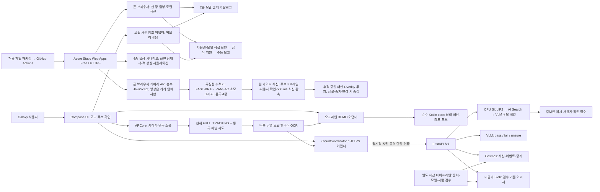
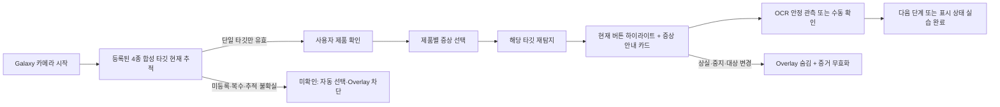
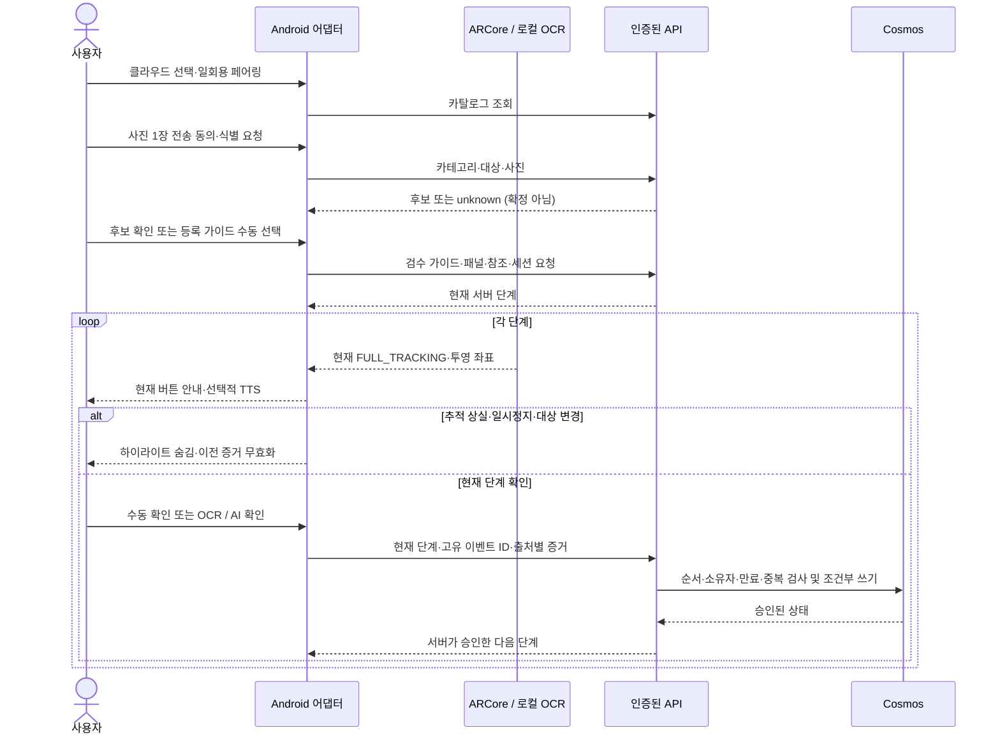
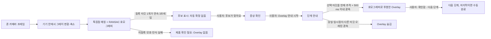

## Mock-up 테스트 앱 설치 및 바로 접속

폰 카메라로 합성 제품 패널을 비추면 제품을 인식하고, 지금 조작할 위치에 Overlay가 따라붙는 웹 DEMO다.
PC 또는 두 번째 화면에 아래 둘째 줄의 타깃을 띄우고, 폰에서 첫째 줄을 열어 `카메라 시작`을 누른다.

| 용도 | 설치 및 접속 링크 |
|------|------------------|
| 폰에서 설치 없이 카메라 AR Overlay | [Azure 모바일 웹 카메라 AR DEMO](https://agreeable-coast-0b8033d00.5.azurestaticapps.net/) |
| 카메라로 비출 합성 타깃 (PC·두 번째 화면) | [카메라 AR용 타깃 4종](https://agreeable-coast-0b8033d00.5.azurestaticapps.net/product-demo.html?ar=1) |
| 카메라 없이 4종 시나리오 시험 | [에어컨·세탁기·냉장고·모니터 합성 Overlay](https://agreeable-coast-0b8033d00.5.azurestaticapps.net/product-demo.html) |
| 폰 사진 한 장 참조 (모델 2종) | [에어컨·모니터 사진 참조 DEMO](https://agreeable-coast-0b8033d00.5.azurestaticapps.net/photo-demo.html) |
| Galaxy 0.2 사전 시험 APK | [에어컨·모니터 사진 참조 APK](https://github.com/daeungo1/visual-product-recognition/releases/download/v0.2.0-photo-demo/app-android-debug.apk) |
| 0.2 배포 정보 및 무결성 | [사진 참조 사전 릴리스](https://github.com/daeungo1/visual-product-recognition/releases/tag/v0.2.0-photo-demo), [APK SHA-256](https://github.com/daeungo1/visual-product-recognition/releases/download/v0.2.0-photo-demo/app-android-debug.apk.sha256) |
| 기존 0.1 공개본 | [합성 Mock-up Release](https://github.com/daeungo1/visual-product-recognition/releases/tag/v0.1.0-mockup) |
| PC 제품별 시나리오·타깃 | [에어컨·세탁기·냉장고·모니터 Overlay 목업](https://daeungo1.github.io/visual-product-recognition/) |
| 웹 소스 | [카메라 AR HTML](./assets/ar-demo.html), [AR 추적 모듈](./assets/ar/), [모바일 사진 참조 HTML](./assets/photo-demo.html), [공유 모델 출처](./assets/products/catalog.json) |
| Foundry 모델 영역 제안 (PC 로컬 시험) | [gpt-6.1-terra 영역 제안 DEMO](#foundry-영역-제안-로컬-시험) |
| 설치·페어링·시험 순서 | [Galaxy 테스트 안내](./docs/galaxy-test.md) |
| HTTPS API | [liveness](https://ca-svg-dev-4ca0.whiterock-2d71d661.japaneast.azurecontainerapps.io/healthz), [readiness](https://ca-svg-dev-4ca0.whiterock-2d71d661.japaneast.azurecontainerapps.io/readyz) |
| 공개 소스 | [daeungo1/visual-product-recognition](https://github.com/daeungo1/visual-product-recognition) |

> [!WARNING]
> 웹 카메라 AR은 등록한 합성 패널 4종만 인식하며 실제 삼성 제품은 인식하지 않는다.
> ARCore가 아니라 브라우저 안의 자체 특징점 추적기이며, 실제 폰·Galaxy 카메라 시험은 아직 하지 않았다.
> 합성 추적·로컬 사진 참조용 개발 서명 APK이며 실제 삼성 제품 지원 앱이 아니다.
> APK 컴파일과 자동 테스트는 Galaxy 설치·카메라·AR 정합 검증을 의미하지 않는다.
> 설치가 차단된 폰은 위 Azure 웹을 사용한다. 단말 보안 정책을 우회하지 않는다.
> 웹은 Android의 ARCore·OCR·TTS·인증 API 기능을 이식한 것이 아니며 단계 완료는 수동 확인이다.
> API 주소는 브라우저용 앱 화면이 아니며, 클라우드 이용에는 별도 단말 페어링이 필요하다.

0.2 APK는 고정된 사전 릴리스이며 이번 웹 배포로 파일·태그·체크섬을 덮어쓰지 않았다.
카메라 AR 변경은 순수 JS 추적·세션 검사 90개, API·평가·게시 검사 113개, core 8개,
Android 25개를 통과했고 Android lint는 오류 0개, 경고 5개다.
모두 합성 타깃과 가상 카메라를 쓰는 PC·CI 검사이며 폰 카메라 성능을 뜻하지 않는다.
사진 가져오기 시험에는 소유한 합성 PNG 및 생성 이미지를 사용했고 실제품 인식으로 계산하지 않았다.
폰 카메라의 인식 거리·속도, Galaxy 설치, 에뮬레이터, 실제품, 터치 시험은 미실시다.
이전 배포의 사진 참조 공개 웹 DOM 검사 75개와 0.1 공개 웹 검사 37개는 이전 결과이며
[검증 기록](./docs/verification.md)에 분리했다.

### Foundry 영역 제안 로컬 시험

Azure Foundry의 `gpt-6-1-terra`(리소스 `brk445demo-01`, GlobalStandard 용량 100)가 사진에서 부품별 점·박스 초안을 제안한다.
인증 없는 API를 공개하지 않으므로 공개 웹·APK에는 연결하지 않았고, 개발자 PC에서만 127.0.0.1로 실행한다.
폰 접속은 제공하지 않는다. 제안은 사람 검수 전 초안이며 Overlay 표시에 쓰지 않는다.

```powershell
az login
cd server
$env:PYTHONPATH = "src"
$env:FOUNDRY_ENDPOINT = "https://brk445demo-01.cognitiveservices.azure.com/"
.\.venv\Scripts\python.exe -m guide_api.region_demo
```

브라우저에서 `http://127.0.0.1:8890/`을 열고 합성 시나리오 이미지
(예: [에어컨](./assets/scenarios/aircon.png), [모니터](./assets/scenarios/monitor.png))와 부품 이름을 넣으면
노란 박스와 빨간 점이 겹쳐 보인다. 모델 배포는 `FOUNDRY_DEPLOYMENT`로 바꿀 수 있다.

확인한 것: 합성 에어컨·모니터 이미지로 API 호출 2건이 성공했고 부품 2개씩 초안 영역을 받았다(PC 호출, 합성 이미지).
서버 테스트 113개와 ruff를 통과했다. 정확도 측정, 브라우저 화면 확인, 폰, 실제 삼성 제품은 미실시다.
SAM2·Grounded-SAM은 아직 배포하지 않았다. 자세한 내용은 [설계 노트](./docs/guide-fit-consensus.md)에 있다.

### 폰 브라우저에서 카메라 AR Overlay 시험

1. PC 또는 두 번째 화면에서
   [카메라 AR용 타깃](https://agreeable-coast-0b8033d00.5.azurestaticapps.net/product-demo.html?ar=1)을 열고
   에어컨·세탁기·냉장고·모니터 중 한 합성 제품을 고른다. 화면 밝기를 높인다.
2. 폰의 Chrome 또는 Samsung Internet에서
   [카메라 AR DEMO](https://agreeable-coast-0b8033d00.5.azurestaticapps.net/)를 열고
   `카메라 시작`을 눌러 권한을 허용한다. HTTPS 주소와 카메라 권한이 필요하다.
3. 타깃 전체가 보이고 화면의 3분의 1 이상을 차지하도록 정면에서 비춘다.
   반사와 흔들림을 피하고, PC 화면의 가는 줄무늬(모아레)가 보이면 거리나 각도를 바꾼다.
4. 같은 등록 타깃이 연속 3프레임 인식되면 후보가 나타난다.
   맞으면 `후보가 맞아요`를 누르고 증상을 확인한 뒤 `Overlay 안내 시작`을 누른다.
5. 노란 Overlay는 현재 추적 중인 타깃 위에만 따라붙는다.
   타깃을 가리거나 치우거나 다른 제품으로 바꾸면 곧바로 사라져야 한다. 이 동작을 직접 확인한다.
6. Overlay가 가리킨 PC 타깃의 영역을 눌러 가상 표시를 바꾼 뒤 폰에서 `확인함 · 다음 단계`를 누른다.
   단계 완료는 항상 사용자가 직접 누르는 수동 확인이며 앱이 상태를 자동 판정하지 않는다.
7. 카메라가 없으면 `카메라 없이 합성 영상으로 확인`으로 같은 흐름을 가상 영상에서 시험한다.
   `직접 선택`은 인식을 건너뛰므로 인식 성공으로 세지 않으며, 이때도 Overlay는 선택한 타깃이
   현재 추적 중일 때만 보인다. 합성 영상의 `대상 없음`이나 등록되지 않은 대상은 `제품 확인 필요`로 남고 제품을 추정하지 않는다.

AR 페이지의 `타깃 이미지 4종 보기`를 다른 화면에 띄워 비출 수도 있다.
이 경우 표시 상태가 바뀌지 않으므로 Overlay 위치 확인에만 쓰고, 단계 실습에는 PC 타깃 화면이 알맞다.
인쇄물 인식은 시험하지 않았다.
카메라 영상은 폰 안에서만 분석하며 저장하거나 서버로 전송하지 않는다.

### 폰 사진 참조 시험

1. [사진 참조 웹](https://agreeable-coast-0b8033d00.5.azurestaticapps.net/photo-demo.html)을
   Chrome 또는 Samsung Internet에서 열고 에어컨·모니터 모델을 선택한다.
2. `폰 카메라로 사진 한 장 촬영` 또는 로컬 사진 선택으로 사용권 있는 JPEG/PNG를 불러온다.
   브라우저·회사 단말 정책에 따라 촬영 대신 파일 선택기가 열릴 수 있다.
3. 사진 사용권과 선택 모델 일치를 직접 확인하고 `사진 참조 안내 시작`을 누른다.
4. 모델별 증상 참조 카드와 공식 지원을 확인하고 미해결·판정 불가·사용자 해결 보고를 선택한다.
5. 사진·모델 변경, 확인 해제, 모델 미확인, 초기화와 페이지 이탈 시 이전 확인·결과가 지워지는지 확인한다.

사진은 웹 서버로 전송하지 않는다. 촬영 원본의 갤러리 저장 여부는 단말·카메라 앱 정책에 따른다.

[4종 합성 Overlay](https://agreeable-coast-0b8033d00.5.azurestaticapps.net/product-demo.html)는
카메라 없이 폰 한 대에서도 시험할 수 있다. 제품을 고른 뒤 노란 영역을 눌러 가상 표시를 바꾸고
`표시 상태 확인`으로 진행한다. 추적 상실 버튼은 시뮬레이션일 뿐 실제 카메라 추적이 아니다.

### Galaxy APK 카메라 추적 시험

1. PC에서 [제품 이슈 Overlay 목업](https://daeungo1.github.io/visual-product-recognition/)을 열고
   에어컨·세탁기·냉장고·모니터 중 한 합성 제품을 선택한다.
2. Android 8.0 이상 Galaxy에 APK를 설치한다. 카메라 추적은
   [ARCore 지원 기기](https://developers.google.com/ar/devices)와 Google Play Services for AR가 필요하다.
3. 앱의 `카메라로 제품 이슈 DEMO`에서 PC 타깃 전체를 비춘다.
   감지된 합성 제품을 사용자가 확인하고 해당 증상의 `Overlay 안내 시작`을 누른다.
   계정, 페어링 및 사진 업로드 없이 실행한다.
4. 현재 FULL_TRACKING에서만 버튼 하이라이트와 증상 안내 카드가 카메라에 표시된다.
   PC의 해당 영역을 눌러 표시 상태를 바꾸고 OCR 또는 수동 확인으로 진행한다.
   추적 상실·다른 제품·앱 중지 시 이전 안내를 숨긴다.
5. 실제 식별·AI 확인·세션 저장 시험은 `실제 HTTPS 클라우드 연결`을 선택하고
   운영자 발급 일회용 코드로 페어링한다. 공개 README에는 코드를 제공하지 않는다.

## 현재 구현

### 인터넷 사진 조사에 기반한 실모델 2종

| 종류 | 확인한 모델 | 공식 사진 원본 및 제품 지원 |
|------|-------------|-----------------------------|
| 에어컨 | AF90H19D35WN, Bespoke AI 무풍콤보 갤러리 프로 청정 | [공식 제품·사진](https://www.samsung.com/sec/business/air-conditioners/floor-standing-af90h19d35wn-d2c/AF90H19D35WN/), [모델 지원](https://www.samsung.com/sec/support/model/AF90H19D35WN/) |
| 모니터 | LS32HG802SKXKR, Odyssey OLED G8 G80SH | [공식 제품·사진](https://www.samsung.com/sec/monitors/gaming-ls32hg802skxkr-d2c/LS32HG802SKXKR/), [모델 지원](https://www.samsung.com/sec/support/model/LS32HG802SKXKR/) |

2026 제품군의 두 모델을 공식 페이지와 대조했다. 검색 요약의 잘못된 연식과
번들·세부 모델 혼동을 그대로 채택하지 않았다.
공식 사진의 APK·공개 저장소 재배포 권한은 확인되지 않아 사진 파일은 내장하지 않았다.
[사진 참조 웹 DEMO](https://agreeable-coast-0b8033d00.5.azurestaticapps.net/photo-demo.html) 또는
APK `에어컨·모니터 실모델 사진 참조 DEMO`에서 아래 순서로 시험한다.

1. 모델을 선택하고 공식 사진 원본 페이지에서 해당 모델을 확인한다.
2. 웹에서 한 장을 촬영하거나 사용권 있는 JPEG/PNG를 로컬에서 불러온다(10 MiB·20 MP 이하).
3. 사진 사용권과 정확한 모델 일치를 사용자가 직접 확인한다.
4. 증상 안내 카드를 보고 선택 모델의 공식 지원을 연다.
5. 미해결·판정 불가·사용자 해결 보고를 수동으로 기록한다. 자동 성공은 없다.

이 흐름은 단일 사진 미리보기이며 연속 카메라·모델 자동 식별·AR 추적이 아니다.
사진 또는 모델 변경·모델 미확인·이미지 오류 시 확인과 결과를 지운다.
사진은 메모리에서만 사용하며 서버 전송·영구 보관하지 않는다.
미검수 버튼 좌표·공식 조작 절차를 새로 게시하지 않고 공식 출처로 연결한다.

웹 소스는 저장소 루트에서 아래처럼 제공한 뒤
`http://127.0.0.1:8879/photo-demo.html`을 연다. 파일을 직접 열면 카탈로그 fetch가 차단될 수 있다.
Python 환경은 아래 빌드·검증 절차로 먼저 준비한다.

```powershell
.\server\.venv\Scripts\python.exe -m http.server 8879 --bind 127.0.0.1 --directory .\assets
```

### 웹 카메라 AR Overlay

고객 시나리오의 “비춤 → 인식 → 해결 Overlay”를 설치 없이 폰 브라우저에서 시험하는 PoC다.
등록한 합성 패널 4종만 인식하며 삼성 실제 제품은 인식하지 않는다.
Android 앱의 ARCore·OCR 경로와는 별개이고 전체가 순수 JavaScript다.
라이브러리·WASM·Worker가 없고 영상은 폰 안에서만 분석하며 저장하거나 전송하지 않는다.

| 처리 단계 | 동작 | 코드 |
|-----------|------|------|
| 카메라 | 후면 카메라를 열고 기기 속도에 맞춰 분석 크기를 조절한다. 프레임은 메모리에서만 쓴다 | [camera.js](./assets/ar/camera.js), [budget.js](./assets/ar/budget.js) |
| 특징점 | 그레이 프레임에서 FAST-9 코너와 방향 보정 BRIEF-256 기술자를 뽑는다 | [features.js](./assets/ar/features.js) |
| 인식·추적 | 등록 타깃 4종과 매칭하고 RANSAC 호모그래피로 타깃 꼭짓점을 구한다. 비슷한 후보가 있으면 미확정이다 | [tracker.js](./assets/ar/tracker.js), [geometry.js](./assets/ar/geometry.js) |
| 증거 규칙 | 후보는 연속 3프레임, 사용자 확인, 500 ms 이내 최신 관측, 단계 수동 확인이 필요하다 | [session.js](./assets/ar/session.js) |
| Overlay | 카탈로그의 정규화 좌표를 현재 호모그래피로 투영하고 추적 중에만 그린다 | [overlay.js](./assets/ar/overlay.js) |
| 안내 패널 | 세션 상태에서 문구와 버튼을 도출하고 미확정·상실을 비성공 상태로 표시한다 | [guide.js](./assets/ar/guide.js) |

Overlay는 현재 프레임에서 등록 타깃을 추적하는 동안에만 그린다.
타깃 상실, 일시 중지, 다른 타깃, 오래된 관측이면 즉시 숨기며 기억한 자세나 고정 화면 좌표로 대신하지 않는다.
중복·이전 단계·오래된 확인은 거절하고, 등록되지 않은 대상이나 모호한 후보는 `제품 확인 필요`로 남긴다.
`직접 선택`은 인식 성공으로 세지 않는다.

아래 측정은 모두 합성 영상과 PC 실행 결과이며 실제 폰이나 실제품의 결과가 아니다.

| 항목 | 결과 | 조건 |
|------|------|------|
| 오인식 | 80회 중 0건 (정상 인식 77회, 미인식 3회) | 회전 ±35°, 기울기 ±25°, 블러·노이즈·밝기 변화를 준 합성 프레임 |
| 등록 외 대상 | 추적 0건 | 미등록 합성 제품과 배경만 있는 프레임 |
| 제품 전환 | 12가지 전환 모두 이전 제품을 다시 보고하지 않고 새 제품을 2프레임 이내 인식 | 같은 자세에서 화면만 다른 합성 제품으로 교체 |
| 추적 정밀도 | 최대 꼭짓점 오차 0.67 px | 손으로 든 듯한 90프레임 합성 시퀀스 |
| 인식 범위 | 타깃 면적이 프레임 면적의 11% 이상(분석 긴 변 512 px), 20% 이상(416 px), 27% 이상(336 px)일 때 12회 모두 인식 | 면적 6~50% 8단계 각 12회, 오인식 0건 |
| PC 처리 시간 | 288×512 분석 프레임에서 추적 중 중앙값 약 11 ms, 새로 찾기 중앙값 24~36 ms | 데스크톱 4회 실행 범위, 폰은 미측정 |

표의 면적보다 작게 비추면 일부 또는 전부 인식하지 못했고 오인식은 없었다.
35%와 50%는 세 단계 모두 12회 모두 인식했으므로 화면의 3분의 1 이상을 채우도록 안내한다.
타깃이 프레임을 넘치면 추적기는 미확정 또는 없음으로 판정했고 다른 제품으로 오인하지 않았다.
Overlay는 마지막으로 분석한 프레임을 따르므로 PC 합성 영상에서 약 0.1~0.3초 늦다.
분석이 오래 걸려 관측이 500 ms보다 오래되면 Overlay를 숨긴다. 의도한 보수적 동작이다.

남은 한계는 다음과 같다.

* 합성 패널 4종만 인식한다. 삼성 실제 제품 사진은 인식하지도 포함하지도 않는다.
* 학습한 AI 모델이 아니라 특징점 매칭이다. 무늬가 적거나 반사·흔들림·모아레가 심하면 추적이 약해진다.
* 폰 카메라, Galaxy, iOS Safari에서 인식 거리·속도·발열은 측정하지 않았다.
* 단계 완료는 사용자가 누르며 화면 상태나 고장 해결을 자동 판정하지 않는다.
* 사용자가 자기 제품 사진을 등록하는 모드는 아직 없다. 실제품 버튼 좌표와 안내 문구는
  출처·적용 모델·사람 검수가 있어야 게시할 수 있어 다음 단계로 남겼다.

### 기존 카메라 추적 합성 DEMO

목표 고객 시나리오는 “삼성 제품을 비춤 → 모델 확인 → 증상 선택 →
제품 위에 해결 절차 Overlay → 결과 확인 또는 공식 지원 연결”이다.
현재 구현은 이 흐름을 아래 네 가지 독립 합성 패널로 시험하는 목업이다.

| 제품형 DEMO | 증상 | 합성 표시 확인 순서 |
|-------------|------|---------------------|
| 에어컨 | 시원한 바람이 나오지 않아요 | POWER ON → MODE COOL → TEMP 24 |
| 세탁기 | 세탁이 시작되지 않아요 | POWER ON → DOOR CLOSED → READY YES |
| 냉장고 | 냉기가 약하게 느껴져요 | POWER ON → MODE COOL → TEMP 3 |
| 모니터 | 화면에 신호가 없어요 | POWER ON → INPUT HDMI → SIGNAL OK |

위 상태와 숫자는 가상 실습값이지 삼성 공식 조작 절차나 실제 권장 설정이 아니다.
표시 일치는 실제 냉방·냉각·문 잠금·세탁 운전·영상 복구를 입증하지 않는다.
브라우저의 `표시 상태 확인`도 OCR·VLM 판정이 아닌 PC 시뮬레이션 비교다.
실제품 모델·검수 패널이 없으면 “미등록/모델 확인 필요”로 남기고 임의 Overlay를 표시하지 않는다.

Galaxy에서 카메라로 등록된 대상을 비추고 버튼 안내와 단계 진행을 시험하는
Kotlin/Compose 앱이다. 오프라인 DEMO와 실제 HTTPS 클라우드 모드를 명시적으로 구분한다.
클라우드 오류를 오프라인 성공이나 임의 AI 결과로 대체하지 않는다.

실제 Azure Container Apps, CPU SigLIP2, AI Search, Azure OpenAI,
Cosmos DB와 비공개 Blob을 구성했다. API는 관리 ID로 Azure에 접근한다.
Cosmos와 Blob은 공용 접근을 차단하고 VNet의 Private Endpoint로 연결한다.
공식 ARCore 1.48 도구에서 기존 리모컨은 100점,
새 제품형 참조는 에어컨100·세탁기90·냉장고100·모니터100점으로
권장 최소 75점을 통과했다. SDK 참조 품질이며 실기기 정합 성능은 아니다.

현재 Azure에 등록된 자산은 직접 제작한 기존 합성 리모컨과
`POWER ON → MODE COOL → TEMP 24` 가이드다.
새 4종 제품형 패널은 Android 오프라인·웹 데모에 포함했다.
클라우드 카탈로그에 자동 게시하거나 기존 Azure 서비스를 재배포하지 않았다.
삼성 실제 모델, 공식 가이드 및 실제품 사진을 임의로 등록하지 않았다.
실제 삼성 제품의 식별 정확도나 버튼 정합, 사용자 완주율을 입증한 결과는 아니다.
연결된 Galaxy가 없어 카메라, OCR, TTS 및 실제 정합의 실기기 시험은 남아 있다.

## 바로 시험하기

* [설치 없는 카메라 AR 웹 DEMO (폰 브라우저)](https://agreeable-coast-0b8033d00.5.azurestaticapps.net/)
* [AR 시험용 PC·보조 화면 타깃](https://agreeable-coast-0b8033d00.5.azurestaticapps.net/product-demo.html?ar=1)
* [설치용 APK와 체크섬](https://github.com/daeungo1/visual-product-recognition/releases/latest)
* [4종 제품 이슈·Overlay 웹 목업](https://daeungo1.github.io/visual-product-recognition/)
* [기존 HTTPS 시나리오용 합성 리모컨](https://daeungo1.github.io/visual-product-recognition/demo-target.html)
* [오프라인 PC 타깃 소스](./assets/demo-target.html), [같은 폴더에 둘 PNG](./assets/demo-target.png)
* [Galaxy 시험 순서 및 페어링](./docs/galaxy-test.md)
* [검증 결과와 알려진 제한](./docs/verification.md)
* [실제 Azure 구성과 재배포](./docs/azure-architecture.md)

API 원점:

```text
https://ca-svg-dev-4ca0.whiterock-2d71d661.japaneast.azurecontainerapps.io
```

아래는 기존 클라우드 등록 리모컨의 실제 API 시험이다. 새 4종 합성 패널은
맨 위의 카메라 기반 오프라인 제품 이슈 DEMO에서 시험한다.

1. PC에서 기존 합성 리모컨 타깃을 연다. 오프라인 HTML 사용 시 같은 폴더의 PNG도 필요하다.
2. 지원되는 Galaxy에 APK를 설치하고 `실제 HTTPS 클라우드 연결`을 선택한다.
3. 운영자의 일회용 코드를 입력하고 `페어링 · 연결`을 누른다.
   코드와 토큰은 APK에 포함하지 않는다.
4. `에어컨`, `리모컨`을 선택하고 사진 전송 동의 후
   `사진 1장 · 실제 식별`을 누른다.
5. 반환된 DEMO 후보를 사용자가 확인하고 가이드를 선택한다.
6. 타깃 전체가 추적되면 현재 버튼 위에 안내가 나타난다.
   PC 타깃의 버튼을 눌러 상태를 바꾸고 OCR, AI 또는 수동 확인을 시험한다.

사진 전송이 필요 없는 시험은 `카메라로 제품 이슈 DEMO` 또는
`기존 리모컨 · 오프라인 DEMO`를 선택한다.
이 모드의 진행은 메모리 전용이다. 클라우드 모드는 서버 승인과 Cosmos 세션을 사용하며
저장 단말 및 세션 복원 기능을 제공한다. 단말 토큰 만료 후에는 새 코드가 필요하다.

## 코드 구조

| 위치 | 책임 |
|------|------|
| [core](./core/) | 프레임워크 없는 Kotlin 도메인, 상태 머신, 좌표 및 포트 |
| [app-android](./app-android/) | Compose, 로컬 사진 참조, ARCore, 한국어 ML Kit OCR, TTS, 암호화 단말 등록과 HTTPS 어댑터 |
| [server](./server/) | FastAPI, 실제 Azure 어댑터, 인증, 후보 검색, 단계 판정과 조건부 세션 쓰기 |
| [pipeline](./pipeline/) | 자체 자산 생성, 검수 자산 등록, 검색 활성화, 비공개 페어링 및 정적 웹 allowlist 패키징 |
| [assets](./assets/) | 실모델 사진 출처, 4종 공유 시나리오 카탈로그, 합성 타깃·패널 지도·대화형 HTML, 웹 카메라 AR 모듈 |
| [assets/ar](./assets/ar/) | 브라우저용 순수 JavaScript AR: 특징점 추출, 호모그래피 추적기, 증거 세션, Overlay·안내 패널 도출, 카메라 |
| [web-tests](./web-tests/) | AR 모듈의 Node 테스트 90개. 합성 프레임과 모의 카메라를 쓰며 DOM·네트워크 없이 실행 |
| [infra](./infra/) | 기본 서비스, 사설 네트워크, API 단독 배포 및 별도 Free 정적 웹 Bicep |
| [eval](./eval/) | 라벨 기반 식별, 정합, 완주 지표와 부족한 데이터 처리 |

ARCore만 카메라를 소유한다. CameraX가 별도 카메라를 열지 않는다.
등록 이미지와 카메라가 모두 현재 추적 중일 때만 하이라이트와 OCR을 사용한다.
마지막 알려진 자세, 가림, 추적 상실 및 앱 중지 시 안내를 숨긴다.
OCR은 표시 상태를 확인할 뿐 물리 버튼을 눌렀거나 부품을 장착했다는 증거는 아니다.

## 아키텍처

읽기 순서는 `Galaxy UI → 외곽 어댑터 → 순수 core`다.
카메라는 ARCore가 단독 소유하고 현재 추적 중인 등록 타깃 좌표만 투영한다.
오프라인은 로컬 상태 머신, 클라우드는 인증된 API와 Cosmos 승인 상태를 사용한다.



* `core`는 Android, ARCore, ML Kit, HTTP 및 Azure SDK를 참조하지 않는다.
* 사진 참조는 [PhotoDemoScreen](./app-android/src/main/java/kr/demo/visualguide/PhotoDemoScreen.kt)과
  [사진 출처 카탈로그](./assets/products/catalog.json)를 사용하는 별도 외곽 어댑터다.
  브라우저도 같은 카탈로그를 읽는다. 사진은 로컬 메모리에서만 사용하고
  AR 추적·core 상태 머신·API·클라우드의 성공 증거로 보내지 않는다.
* 제품 이슈 DEMO는 [공유 카탈로그](./assets/scenarios/catalog.json)를
  Android와 웹이 함께 읽는다. 4종 기준 이미지를 ARCore에 등록해 탐지하고
  하나의 타깃이 현재 추적될 때만 제품 확인 후보를 표시한다.
  복수 대상·추적 상실은 자동 선택하지 않는다. 수동 선택은 인식 성공과 구분한다.
* 오프라인 모드는 로컬 상태 머신과 메모리 진행을 사용한다.
  클라우드 모드는 HTTPS 어댑터에서 서버가 승인한 단계만 표시한다.
* Cosmos와 Blob은 Private Endpoint를 사용한다. Galaxy의 API ingress는 공용 HTTPS다.
  Search와 OpenAI까지 사설 연결이라고 표시하지 않는다.
* 웹 카메라 AR은 [순수 JavaScript 모듈](./assets/ar/)이며 core와 Android 코드를 공유하지 않는다.
  같은 [공유 카탈로그](./assets/scenarios/catalog.json)와 합성 PNG 4종을 등록 타깃으로 읽는다.
  추가 네트워크 요청은 카탈로그 읽기와 타깃 이미지 로드뿐이고 영상은 폰 안에서만 분석한다.
  Android의 ARCore 경로를 대체하지 않는다.
* Azure Static Web Apps와 GitHub Pages는 같은 [허용 목록 패키저](./pipeline/stage_web.py)로
  HTML·AR 모듈·합성 PNG·카탈로그·정적 호스트 설정 24개만 게시한다(`index.html`은 진입 페이지 복사본).
  Azure 기본 화면은 웹 카메라 AR, 기존 Pages 기본 화면은 4종 합성 타깃이다.
  API·SQLite·개인 사진·자격 증명은 포함하지 않는다. 웹은 기존 인증 API를 호출하지 않는다.
* [실제 Azure 토폴로지](./docs/azure-architecture.md)와
  [API 계약](./docs/cloud-api-contract.md)에 네트워크·권한·요청 형식이 있다.

## 사용자 및 증거 워크플로

제품 이슈 DEMO의 첫 흐름은 다음과 같다. 실제 HTTPS 식별은 아래 별도 흐름이다.

1. 카메라로 등록 합성 제품 하나를 탐지하고 사용자가 제품·증상을 확인한다.
2. 해당 타깃이 현재 추적 중일 때만 버튼 하이라이트와 증상 안내를 표시한다.
3. 안정 OCR 또는 수동 확인으로 다음 단계에 진행하며 완료 출처를 구분한다.
4. 추적 상실·앱 중지·대상 변경은 안내와 이전 증거를 무효화한다.
5. 클라우드는 일회용 페어링·사진 동의·후보 확인을 추가하고, 현재 단계의
   유효 증거·고유 이벤트 ID를 검증한 뒤 서버가 진행을 승인한다.





AI 확인은 별도 `/verify` 요청으로 현재 단계용 30초 증거를 발급한 뒤
진행 이벤트에서 소비한다. `fail`, `unsure`, `unknown`, 오류는 성공이 아니다.
같은 이벤트 재시도는 원래 응답을 반환하며 실제 최신 세션을 다시 읽어
화면이 과거 단계로 돌아가지 않도록 한다.
수동 확인과 자동 확인은 출처를 분리한다.
사진은 버튼을 명시적으로 누를 때만 보내며, 연속 카메라 프레임을 서버에 업로드하지 않는다.

### 웹 카메라 AR 증거 흐름

폰 브라우저의 AR은 서버나 클라우드를 거치지 않고 같은 증거 원칙을 기기 안에서 적용한다.
증거 규칙은 [session.js](./assets/ar/session.js), 화면에 그릴 도형은 [overlay.js](./assets/ar/overlay.js),
안내 문구와 버튼 상태는 [guide.js](./assets/ar/guide.js)가 순수 함수로 결정한다.



1. 후보는 같은 등록 타깃이 연속 3프레임 추적될 때만 생기며 사용자가 확인해야 한다.
2. 제품 확인과 모든 Overlay는 선택한 타깃의 500 ms 이내 관측을 요구한다.
3. 단계는 현재 보이는 단계에 대해 순서대로 한 번만 확인할 수 있다.
   중복, 이전 단계, 오래된 관측, 추적 중이 아닌 상태의 확인은 거절한다.
4. 페이지가 숨겨지거나 카메라가 멈추면 이전 관측을 모두 무효화한다.
5. `직접 선택`은 인식 성공으로 세지 않으며 이 데모의 완료 출처는 항상 수동이다.

## 고객 요구사항 대비 구현과 부족한 근거

제공된 별도 고객 승인 PRD는 없다. 아래 항목은 직접 요청한
“삼성 에어컨·세탁기·냉장고·모니터를 비추면 이슈 해결 Overlay”와
[기존 PoC 범위](./docs/poc-plan.md), [리서치 요구사항](./docs/research-review.md)을
기준으로 대조했다. 구현 여부와 실제 고객 환경의 성능 입증은 별개다.

| 요구 | 현재 구현·검증 | 판정 또는 남은 작업 |
|------|----------------|---------------------|
| 제품을 비추면 증상별 Overlay | 웹: 폰 카메라가 합성 패널 4종을 인식하고 추적 중에만 Overlay(PC·가상 카메라 검증). Android: 합성 타깃 탐지·확인·증상·추적 안내 | 합성 패널 한정 목업. 폰·Galaxy 실카메라 시험 미실시, 일반 삼성 실물 범용 인식 아님 |
| Galaxy 설치형 안내 | Compose·ARCore·OCR·TTS, APK와 lint | 컴파일 검증, 실기기 미검증 |
| 제품 식별·후보 확인 | SigLIP2·Search·VLM, unknown과 사용자 확인 구분 | 합성 자산만 확인, 실제품 정확도 미측정 |
| 움직이는 대상 버튼 정합 | 현재 FULL_TRACKING에서만 지도 좌표 투영 | 추적 상실 차단 구현, Galaxy p95 오차 미측정 |
| 단계별 OCR·AI·수동 확인 | 안정 OCR, pass/fail/unsure, 출처 분리 | 상태·계약 자동 테스트, 실제 OCR 정확도 미측정 |
| 중복·지연 응답·복원 | 이벤트 ID, 단계별 증거, 암호화 단말 저장, Cosmos | 자동 테스트, 과거 실제 Azure 검증과 현재 health 구분 |
| 사진 동의·자격 증명 보호 | 명시적 1장 전송, APK에 키 없음, 단말 인증 | 고객 운영 전 보존·동의·접근 정책 확정 필요 |
| 실제 모델·공식 가이드 | 출처·적용 모델·사람 검수 등록 경로 | 실제품 자산 없음, 삼성 제품 지원 미완료 |
| TV 화면과 리모컨 전환 | 대상 종류 선택과 추적 무효화 경계 | 검수된 TV 다중 대상 가이드·실증 없음 |
| 필터 작업·SAM 3·Content Understanding | 현재 런타임에 포함하지 않음 | 별도 자산·안전 검수·범위 승인 필요 |
| 초심자 무도움 완주 | 독립 라벨 평가 러너 | 초심자 5명 이상 시험 미실시 |
| 외부 테스터 접근 | Azure HTTPS 모바일 웹(카메라 AR·사진 참조·합성 시험), 공개 APK·체크섬, Pages PC 타깃 | 설치 없이 폰 브라우저로 시험 가능, 폰 실카메라·네이티브 AR·실제품 검증은 별도 |

실제 모델 식별 Top-1 90%, Top-3 98%, 버튼 정합 p95 25% 이내,
초심자 5명 중 4명 무도움 완주는 [제안 목표](./docs/research-review.md#제안하는-수용-기준)이며
달성 수치가 아니다. 따라서 현재 결과는 고객 요구사항의 합성 목업 검증이고,
실제 삼성 제품용 PoC의 최종 수용 완료는 아니다.

2026-10-26 개선에서는 API가 허용하는 500자 제목·128단계 가이드를
Android가 거절하던 문제와, API 한도 256자를 넘는 페어링 코드를
Android가 전송하던 문제를 회귀 테스트로 재현하고 어댑터에서 수정했다.
코어 계약과 기존 Azure 인프라는 변경하지 않았다.

## 빌드 및 자동 검증

JDK 17, Android SDK 35, Build Tools 35.0.0이 필요하다.
Gradle Wrapper 8.11.1, AGP 8.9.2, Kotlin 2.1.20을 사용한다.
이 환경의 도구는 무시된 프로젝트 전용 폴더에 설치했으며 시스템 JDK를 변경하지 않았다.

자체 타깃 재생성은 기존 서버의 Pillow 환경을 사용한다.
공식 SDK 도구가 설치되어 있다면 점수 검증을 함께 실행한다.

```powershell
uv sync --project .\server --python 3.11
.\pipeline\Generate-DemoTarget.ps1 `
  -ArcoreImgPath (Join-Path $PWD '.tools\arcore-validation-1.48.0\arcoreimg.exe')
```

4종 제품형 패널은 동일한 시나리오 카탈로그에서 다시 만든다.
검사 도구를 지정하면 각 참조의 75점 미만을 실패 처리한다.
최종 참조 점수는 에어컨 100, 세탁기 90, 냉장고 100, 모니터 100이며 실제 정합 정확도가 아니다.

```powershell
.\server\.venv\Scripts\python.exe .\pipeline\generate_scenario_targets.py `
  --arcoreimg .\.tools\arcore-validation-1.48.0\arcoreimg.exe
```

개선한 참조는 콘텐츠 해시가 붙은 새 클라우드 ID로 등록한다.
기존 게시 자산은 덮어쓰지 않는다.
현재 권장 가이드는 `demo-aircon-0097d99781cc`다.

```powershell
$env:JAVA_HOME = Join-Path $PWD '.tools\jdk\jdk-17.0.20.1+1'
$env:PATH = "$env:JAVA_HOME\bin;$env:PATH"
$env:ANDROID_HOME = Join-Path $PWD '.tools\android-sdk'
$env:ANDROID_SDK_ROOT = $env:ANDROID_HOME
$env:GRADLE_USER_HOME = Join-Path $PWD '.tools\gradle-cache'
.\gradlew.bat --no-daemon --max-workers=2 --console=plain `
  '-Pkotlin.compiler.execution.strategy=in-process' `
  '-PVISUAL_GUIDE_API_BASE_URL=https://ca-svg-dev-4ca0.whiterock-2d71d661.japaneast.azurecontainerapps.io' `
  :core:jvmTest :app-android:testDebugUnitTest :app-android:assembleDebug :app-android:lintDebug

Set-Location .\server
uv sync --python 3.11 --extra cloud
uv run --no-sync pytest tests
uv run --no-sync ruff check src tests
uv run --no-sync pytest ..\eval\tests
```

웹 카메라 AR 모듈은 Node 22 이상으로 시험한다. 설치할 의존성이 없고 합성 프레임과
모의 카메라만 쓴다. CI와 같은 호출은 저장소 루트에서 다음과 같다.

```powershell
Set-Location ..
$files = Get-ChildItem .\web-tests -Filter *.test.mjs | ForEach-Object { $_.FullName }
node --test @files
```

연결 모드의 기본 URL은 공개 주소일 뿐 자격 증명이 아니다.
미설정 빌드는 앱에서 HTTPS 원점을 입력할 수 있다.
기업 네트워크에서는 승인된 패키지 미러를 사용하며 TLS 검증을 끄지 않는다.
실제 임베딩 모델은 ACR의 Linux 이미지 빌드 중 로드하고
768차원 유한 정규화 벡터 생성을 검사한다. 로컬 단위 테스트의 가짜 어댑터로
실제 모델 동작을 검증했다고 처리하지 않는다.

### 공개 저장소의 반복 검증과 배포

[검증 workflow](./.github/workflows/validate.yml)는 core·Android·API·평가·웹 AR Node 테스트,
Ruff, APK 빌드와 lint를 실행하고 결과 및 APK를 Actions artifact로 남긴다.
[Pages workflow](./.github/workflows/pages.yml)는 허용 목록의 합성 HTML·AR 모듈·PNG·카탈로그만 게시한다.
[Azure 웹 workflow](./.github/workflows/static-web.yml)는 같은 패키지를 기존 Free 정적 앱에 게시한다.
배포 토큰은 GitHub 암호화 Secret `AZURE_STATIC_WEB_APPS_API_TOKEN`으로만 전달한다.
검증·Pages workflow는 Azure 자격 증명을 사용하지 않는다. 어느 workflow도 유료 리소스를 생성하지 않는다.

Azure 리소스는 `swa-vpr-web-dev-a277`, 리소스 그룹은 `rg-svg-dev-4ca0`,
지역은 East Asia, SKU는 Free다. 정적 배포는 전역 제공되므로 처리·보관 위치 보장을 뜻하지 않는다.
[독립 Bicep](./infra/static-web.bicep)은 Free만 허용하며 기존 API·DB·네트워크를 수정하지 않는다.
추가 웹 비용은 무료 한도 내 $0이며 기존 유료 API 비용과 구분한다.
무료 한도·정책에 막히면 중단하고 별도 승인 없이 유료 SKU로 전환하지 않는다.

`main`의 웹 자산 변경은 자동 배포된다. 수동 재게시도 가능하다.

```powershell
gh workflow run static-web.yml --ref main --repo daeungo1/visual-product-recognition
```

로컬 검토는 기존 파일이 없는 새 출력 폴더에 패키징한다.
같은 출력 폴더 재사용은 오래된 비공개 파일 혼입을 막기 위해 거부한다.

```powershell
.\server\.venv\Scripts\python.exe .\pipeline\stage_web.py --output .\.test-data\web-preview-new
.\server\.venv\Scripts\python.exe -m http.server 8879 --bind 127.0.0.1 --directory .\.test-data\web-preview-new
```

Release APK는 검증한 빌드를 게시한다. Actions의 새 debug APK는 작업마다
개발 서명이 달라질 수 있으므로 기존 설치본과 서명이 다르면 덮어쓸 수 없다.
삭제 후 재설치하면 로컬 단말 등록도 사라지므로 클라우드는 새 페어링이 필요하다.
정식 배포에는 별도의 고정 서명·키 관리·배포 정책이 필요하다.

## API 및 운영

[연결형 API 계약](./docs/cloud-api-contract.md)은 `/v1` 경로를 정의한다.
단말은 한 번만 사용할 수 있는 코드로 페어링하고 24시간 토큰을 받는다.
일반 단말은 자신의 세션만 조회하고 진행한다.
서버에는 코드 및 토큰의 해시만 저장하며 관리자 권한과 단말 권한을 구분한다.
VLM 통과 증거는 현재 단계에 한정된 30초 유효 증거이고 진행 이벤트에서 소비한다.
같은 이벤트의 재전송은 원래 응답을 반환하며 다른 입력의 같은 ID 재사용은 거절한다.

별도의 레거시 로컬 API도 유지한다.
이는 인증 없는 SQLite 데모이며 클라우드 런타임과 혼용하거나 공용으로 노출하지 않는다.

```powershell
Set-Location .\server
$env:VISUAL_GUIDE_MODE = 'local'
uv run --no-sync uvicorn guide_api.main:app --app-dir src --host 127.0.0.1 --port 8000
```

클라우드 자산 등록과 운영 절차는 [Azure 구성](./docs/azure-architecture.md)을 따른다.
실제품은 적용 모델, 공식 출처, 직접 촬영하거나 사용 권한이 있는 기준 이미지와
검수된 패널 지도가 필요하다. 모델명이 없는 상태를 공용 리모컨 외형으로 확정하지 않는다.

## 실측 및 남은 범위

[리서치 검토](./docs/research-review.md)와 [PoC 계획](./docs/poc-plan.md)에
식별, 정합 및 초심자 5명 이상의 완주 시험을 구분했다.
평가 러너는 데이터가 부족하면 수치를 꾸미지 않고 미측정 상태를 표시한다.
SAM 3, Content Understanding, 실제 삼성 필터 작업 및 TV 메뉴 자산은
현재 런타임의 구현 또는 검증 완료 기능으로 표시하지 않는다.
웹 카메라 AR의 인식 범위·속도·정확도는 합성 영상과 PC에서만 측정했다.
폰 카메라·Galaxy·iOS 시험, 사용자가 자기 제품 사진을 등록하는 모드, 실제 삼성 제품 인식은
구현하지 않았거나 시험하지 않았다.

테스트 리소스는 계속 과금된다. 종료 시 [리소스 정리 안내](./docs/azure-architecture.md#비용과-정리)를
확인한다. 소스는 별도의 공개 저장소로 관리하며 다른 상위 Git 저장소에는
커밋하거나 푸시하지 않았다.
