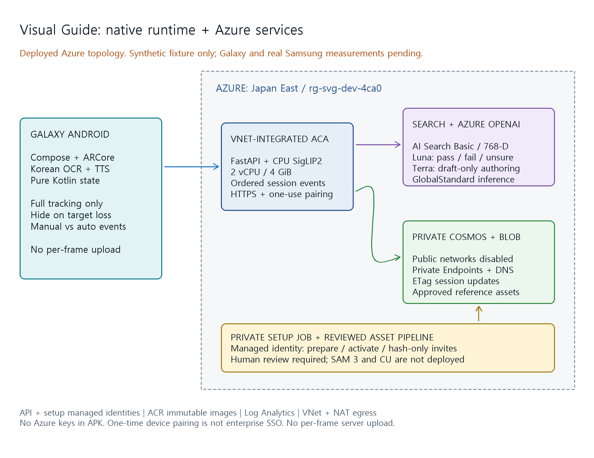

## 배포 대상과 구성

| 항목 | 실제 값 |
|------|---------|
| 구독 | `ME-MngEnvMCAP359144-daeungo-1` |
| 구독 ID | `2cf925b6-80cb-4567-abda-5ccd3010aab5` |
| 테넌트 | `f6d04047-ac77-4fc2-941f-798ed4d54fcf` |
| 리소스 그룹 | `rg-svg-dev-4ca0` |
| 지역 | `japaneast` |
| API | `ca-svg-dev-4ca0` |
| VNet 통합 환경 | `cae-svg-private-4ca0` |
| 전용 설정 작업 | `job-svg-private-4ca0` |



[Excalidraw 원본](./azure-architecture.excalidraw)은 로컬 편집기나
Excalidraw에서 열어 수정할 수 있다.
소프트웨어 및 실호출 결과는 [검증 기록](./verification.md)에서 확인한다.
현재 합성 타깃 하나만 등록하며 실제 Samsung 및 Galaxy 실측을 의미하지 않는다.

## 서비스와 데이터 경로

| 서비스 | 구성 | 책임 |
|--------|------|------|
| Container Apps | Consumption, 2 vCPU/4 GiB, 최소 1/최대 2 복제본 | FastAPI와 로컬 CPU SigLIP2, HTTPS API |
| Azure OpenAI | `ai-svg-dev-4ca0`, S0, 키 인증 비활성 | 이미지 판정과 가이드 초안 |
| AI Search | `srch-svg-dev-4ca0`, Basic, 1파티션/1복제본 | 버전이 고정된 768차원 cosine HNSW |
| Cosmos DB | `cosmos-svg-dev-4ca0`, NoSQL Serverless | 카탈로그, 세션, 단말 및 일회용 초대 |
| Blob | `stsvgdev4ca0`, Standard_LRS, 비공개 `assets` | 검수된 기준 이미지 |
| ACR | `crsvgdev4ca0`, Basic | Linux CPU 이미지와 고정 digest |
| 관리 ID | `id-svg-dev-4ca0`, `id-svg-setup-4ca0` | 런타임 최소 권한과 설정 작업 권한 분리 |
| 관측 | `log-svg-dev-4ca0`, `appi-svg-dev-4ca0` | 런타임 로그와 모니터링 리소스 |
| 네트워크 | VNet, NAT, Private Endpoints, Private DNS | 공용 데이터 접근을 열지 않는 연결 |

1. Android는 ARCore 카메라 한 장 또는 현재 표시창 crop만 명시적으로 전송한다.
2. API는 단말 인증과 입력 경계를 검사하고 CPU SigLIP2로 임베딩한다.
3. Search는 카테고리, 대상 종류와 임베딩 버전으로 검색한다.
4. Luna는 등록 기준 사진과 실제 입력을 비교한다. 확실하지 않으면 unknown이다.
5. 사용자가 후보를 확인하고 검수된 가이드 및 패널 지도를 내려받는다.
6. 추적과 한국어 OCR은 기기에서 실행한다. 매 프레임 서버 전송은 없다.
7. 확인 지점에서만 Luna가 pass/fail/unsure를 반환한다.
8. 통과 증거를 현재 단계에 한정해 발급하고 Cosmos ETag 쓰기로 진행을 승인한다.

고정 임베딩은 `google/siglip2-base-patch16-224`,
revision `75de2d55ec2d0b4efc50b3e9ad70dba96a7b2fa2`다.
이 고정 해상도 SigLIP2 체크포인트의 Transformers 아키텍처 이름은 `siglip`이다.
가중치를 이미지에 포함하고 런타임은 오프라인으로 읽으며 원격 코드를 실행하지 않는다.
Docker 빌드 시 실제 CPU 추론으로 768차원 유한 정규화 벡터를 확인한다.
추적 참조는 공식 ARCore1.48 품질 점수100을 확인했고
콘텐츠 해시 기반 타깃/가이드 ID로 게시해 기존 자산을 보존한다.
현재 참조 버전은 `0097d99781cc`, 전체 인덱스는 기존 참조를 포함해2개다.

| 배포 이름 | 모델 | 버전 | 유형 및 용량 |
|-----------|------|------|--------------|
| `guide-verify` | `gpt-5.6-luna` | `2026-07-09` | GlobalStandard 50 |
| `guide-author` | `gpt-5.6-terra` | `2026-07-09` | GlobalStandard 10 |

GlobalStandard는 추론 처리가 Japan East 안에서만 수행된다는 보장이 아니다.
SAM 3 GPU와 Content Understanding은 배포하지 않았다.
Terra 초안은 draft이며 실제품 카탈로그에 자동 게시하지 않는다.

## 사설 연결과 권한

실제 Cosmos 및 Blob의 공용 네트워크 접근은 Disabled다.
이를 복구 편의를 위해 다시 열지 않았다.

* VNet `vnet-svg-dev-4ca0`: `10.48.0.0/16`
* ACA 위임 서브넷: `10.48.0.0/23`
* Private Endpoint 서브넷: `10.48.2.0/24`
* Cosmos `Sql` 및 Storage `blob` Private Endpoint
* `privatelink.documents.azure.com`, `privatelink.blob.core.windows.net` DNS와 VNet 링크
* NAT Gateway의 공인 IP는 아웃바운드용이며 데이터 서비스 공용 허용 규칙이 아니다.

API의 HTTPS ingress는 Galaxy 접속을 위해 공용이다.
Search와 OpenAI는 HTTPS 및 Entra 관리 ID로 접근하며 키 인증을 비활성화했다.
이 둘까지 Private Endpoint로 구성했다고 표시하지 않는다.

설정 ID에는 검색 스키마와 초기 자산을 준비할 권한이 있고
API ID에는 검색 데이터, Blob 데이터, Cosmos 데이터 및 모델 호출 권한만 부여한다.
API는 검색 스키마 관리 권한을 요구하지 않는다.
원래의 빈 환경 `cae-svg-dev-4ca0`은 삭제하지 않고 유지했다.
앱은 새 사설 환경에 연결되며 빈 기존 환경은 API를 호스팅하지 않는다.

## 페어링 및 운영자 작업

모바일 인증은 일회용 PoC 단말 등록이다. 기업 사용자 Entra SSO를 구현한 것은 아니다.
초대 및 토큰은 Cosmos에 해시로 저장하며 일반 단말은 자신의 세션만 읽는다.
APK에는 관리자 토큰, Azure 키 또는 페어링 코드를 포함하지 않는다.

로컬 PC는 사설 Cosmos/Blob에 직접 접속할 수 없으므로
전용 관리 ID 작업이 VNet 내부에서 다음 작업을 실행한다.

* `prepare`: Search 스키마와 검수된 자산 등록, 초대 발급 없음
* `activate`: API의 일시적 관리자 페어링 및 실제 reindex
* `invite`: 인덱스가 비어 있지 않을 때 해시와 만료만으로 일반 단말 초대 발급

로컬 비밀 코드를 새 무시된 파일에 생성한다.
원문은 로컬 파일에서만 읽고 Azure 작업에는 출력된 해시와 만료만 전달한다.
같은 초대의 작업 재실행으로 이미 소비한 코드를 되살리지 않는다.

```powershell
.\server\.venv\Scripts\python.exe .\pipeline\prepare_bootstrap_context.py `
  --issue-device-code --api-url 'https://ca-svg-dev-4ca0.whiterock-2d71d661.japaneast.azurecontainerapps.io' `
  --code-valid-hours 168 `
  --output '.\.copilot-azure\sessions\4ca09c3a-5987-411f-b048-c102cd4853f2\new-phone-code.private.json'
```

작업 실행 시작 응답은 완료 증거가 아니다.
execution 상태와 로그, 실제 인덱스 개수를 확인한 뒤에만 단말 코드를 전달한다.

## 재빌드와 앱 단독 재배포

[기본 인프라](../infra/main.bicep), [사설 확장](../infra/private.bicep),
[앱 단독 진입점](../infra/app.bicep)을 분리했다.
기존 환경의 앱 이미지를 고칠 때 기본 인프라 전체를 재적용하지 않는다.
아래 예시에서 태그와 digest는 실제 새 빌드 결과로 바꾼다.
`what-if` 결과를 검토한 다음 create를 실행한다.

```powershell
.\server\.venv\Scripts\python.exe .\pipeline\prepare_bootstrap_context.py
Push-Location .\server
az acr build --registry crsvgdev4ca0 --image guide-api:<new-tag> `
  --file Dockerfile --timeout 1800 --no-logs `
  --subscription 2cf925b6-80cb-4567-abda-5ccd3010aab5 .
Pop-Location

az deployment group what-if --name svg-api-update --resource-group rg-svg-dev-4ca0 `
  --subscription 2cf925b6-80cb-4567-abda-5ccd3010aab5 `
  --template-file .\infra\app.bicep --parameters '@infra\app.parameters.json' `
  --parameters 'containerImage=crsvgdev4ca0.azurecr.io/guide-api@sha256:<actual-digest>'

az deployment group create --name svg-api-update --resource-group rg-svg-dev-4ca0 `
  --subscription 2cf925b6-80cb-4567-abda-5ccd3010aab5 `
  --template-file .\infra\app.bicep --parameters '@infra\app.parameters.json' `
  --parameters 'containerImage=crsvgdev4ca0.azurecr.io/guide-api@sha256:<actual-digest>' `
  --query properties.provisioningState -o tsv
```

새 환경을 처음 생성할 때는 기본 서비스, 역할, 사설 확장, prepare,
실제 이미지 앱 배포, activate 및 invite 순서를 따른다.
리소스 이름과 구독을 새 환경에 맞춰 검토하고 별도 승인한다.

## 비용과 정리

기능 우선으로 최소 1개 복제본을 유지한다.
2026-10-21 조회 단가에 2 vCPU/4 GiB를 월 730시간 모두 active로 가정하면
CPU 및 메모리 USD 157.68, Search Basic USD 97.09, ACR 약 USD 4.998,
소계 약 USD 259.768/월이다.
이는 실제 청구액 또는 전체 예산이 아니다.
AI 토큰, Cosmos RU, Blob, 로그, 빌드, NAT, Private Endpoint와 전송은 별도다.
NAT와 Private Endpoint의 정확한 지역 단가를 확보하지 못했으며 무료로 보지 않는다.

배포 리소스는 계속 유지되므로 사용을 마쳤다면 사용자가 범위를 확인한 후 정리한다.
다음 명령은 안내일 뿐 이 작업에서 실행하지 않았다.

```powershell
az group delete --name rg-svg-dev-4ca0 `
  --subscription 2cf925b6-80cb-4567-abda-5ccd3010aab5
```

이 리소스 그룹의 모든 자산과 세션도 삭제되므로 필요한 결과를 먼저 보존한다.
포털의 해당 그룹에서 사용량과 비용을 확인한다.
