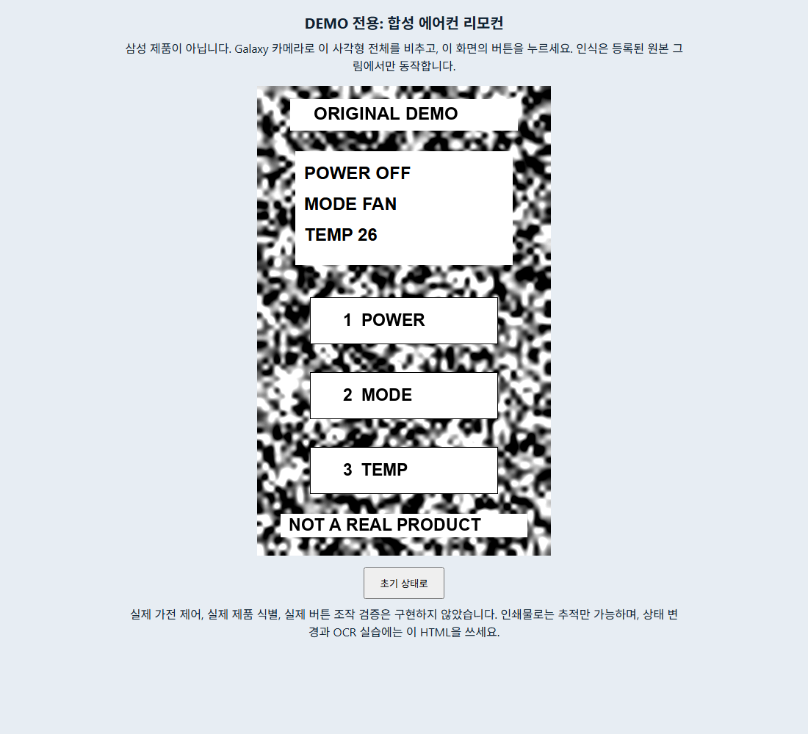

## 2026-10-27 웹 카메라 AR Overlay

[공개 모바일 웹의 루트](https://agreeable-coast-0b8033d00.5.azurestaticapps.net/)는
이제 카메라 AR 데모를 연다. 폰 카메라로 비출 합성 타깃은
[product-demo.html?ar=1](https://agreeable-coast-0b8033d00.5.azurestaticapps.net/product-demo.html?ar=1)을
PC 화면에 띄워 사용한다. 라이브러리와 WASM 없이 순수 JavaScript 모듈 11개로 구현했고
커밋 [f04fd30](https://github.com/daeungo1/visual-product-recognition/commit/f04fd3079dd4ae8e18d1984590f3e165d1854fdf)에
들어 있다. 카메라 영상은 기기 안에서만 분석하며 저장하거나 전송하지 않는다.

| 항목 | 확인 결과 |
|------|-----------|
| 순수 JS 테스트 | 로컬과 공개 CI(Node 22.23.4)에서 90개 통과, 실패 0 (budget 10, camera 7, features 10, geometry 6, guide 18, overlay 19, session 10, tracker 10) |
| Python·Ruff | API·평가·게시 테스트 113개 통과(AR 정적 계약 6개 추가), Ruff 전체 통과, 기존 외부 의존성 경고 1개 |
| 변이 검사 | 정적 계약 변이 29개를 모두 검출하고 변이 없는 기준은 통과, 브라우저 저장소·영상 녹화·프레임 내보내기·Worker·외부 요청·합성 라벨 삭제·카메라 권한 확대·카탈로그 어긋남·게시 목록 누락·CSP 완화 포함 |
| 변이로 찾은 결함 | 같은 자세에서 제품만 바꿔도 이전 제품이 유지되던 문제, 추적 상실 중 탭한 뒤의 거부 문구 오류, 자동 재시작 뒤 남던 이전 거부 문구 3건을 고치고 회귀 테스트 추가 |
| 합성 측정 | 80회 중 오인식 0건(인식 77, 미인식 3), 등록 외 대상 추적 0건, 제품 교체 12회 모두 이전 제품 유지 없음, 손으로 든 듯한 합성 움직임(블러·노이즈 포함) 90프레임 모두 추적하고 최대 꼭짓점 오차 0.67 px |
| 인식 범위 | 면적 6~50% 8단계 각 12회에서 오인식 0건, 타깃이 프레임의 11% 이상(분석 긴 변 512 px), 20% 이상(416 px), 27% 이상(336 px)이면 12회 모두 인식 |
| PC 처리 시간 | 288×512 분석 프레임에서 추적 중 중앙값 약 11 ms, 새로 찾기 24~36 ms, 데스크톱 4회 실행 범위이며 폰은 미측정 |
| 공개 사이트 흐름 | 합성 영상 모드(“시뮬레이션 · 실제 카메라 아님” 표시)에서 후보 확인, 증상 선택, Overlay 안내 1/3 단계(POWER) 표시, 수동 확인 뒤 다음 단계 진행과 완료 출처 `manual` 기록 |
| 추적 상실·타깃 교체 | 추적 상실 시 Overlay 숨김까지 62 ms, 단계 유지, 확인 버튼 비활성. 같은 타깃이 돌아오면 41 ms에 같은 단계에서 재표시. 다른 타깃(세탁기)은 128 ms에 숨기고 218 ms에 후보 단계로 초기화하며 완료 기록 삭제. PC에서 한 번 잰 값 |
| 연결 페이지 | `product-demo.html?ar=1`은 페이지 안 하이라이트를 숨기고 AR 데모로 연결, 일반 `product-demo.html`은 하이라이트 표시, `photo-demo.html`은 로드되며 AR 데모로 연결 |
| 브라우저 보안 | 세 페이지 모두 CSP 위반 0, 콘솔 오류 0, 외부 요청 0 (AR 페이지 요청 21개는 모두 같은 출처) |
| 공개 HTTPS | SWA 제공 파일 22개와 루트가 커밋 원본 바이트와 일치하고 호스트 설정은 404, GitHub Pages 미러도 22개와 루트 일치, AR 모듈 11개는 `text/javascript` |
| 응답 헤더 | 루트와 `/ar/tracker.js`에서 CSP·no-cache·nosniff·DENY·no-referrer·Permissions-Policy(`camera=(self)`) 6개 확인 |
| 부정 경로 | API·호스트 설정·서버 소스·README·Git 설정·테스트 파일·디렉터리·미존재 파일 등 10개 요청 모두 404 |
| Android 로컬 빌드 | core 테스트 8개, app-android 단위 테스트 25개 통과(강제 재실행, 실패·오류 0), lint 오류 0·경고 5개(KTX 권장 4, 앱 아이콘 1), 로컬 디버그 APK 생성과 apksigner v2 검증, 저장소 assets 24개가 커밋 원본과 일치(줄바꿈 제외) |
| 공개 CI | [Validate](https://github.com/daeungo1/visual-product-recognition/actions/runs/40509632169) 성공(Node·Python·Android 단계 포함), [Azure 웹 게시](https://github.com/daeungo1/visual-product-recognition/actions/runs/40509632177) 성공, [Pages](https://github.com/daeungo1/visual-product-recognition/actions/runs/40509632134) 성공 |
| 미실시 | 폰 카메라의 인식 거리·속도·발열, 물리 Galaxy 설치·카메라·터치, 에뮬레이터, iOS Safari, 실제 삼성 제품, 인쇄한 타깃 인식, OCR·ARCore와의 동등성 |

가상 카메라와 합성 영상 모드는 실제 단말 카메라가 아니다.
측정값은 PC에서 합성 영상으로 얻은 결과이며 폰 카메라의 인식률이나 속도가 아니다.
인식 대상은 등록된 합성 패널 4종뿐이다.
삼성 제품 사진은 재배포하지 않았고 실제품 식별, 실제 버튼 좌표, 고장 해결 성공은 주장하지 않는다.

Pages 미러는 `staticwebapp.config.json`을 효력 없는 일반 정적 파일로 제공한다.
내용은 응답 헤더와 라우트 설정뿐이며 비밀 값은 없다.
이전 기록의 lint 경고 9개와 달리 이번 오프라인 실행은 5개를 보고했다.
이전 경고에 있던 의존성 권고 4개가 나오지 않았고 원인은 확인하지 않았다.

이번 변경은 정적 웹 모듈, 게시 스크립트, CI 설정과 테스트에 한정한다.
Kotlin core 계약, Android 소스, API 코드는 변경하지 않았다.
아래 날짜별 기록의 수치(Python 107개, 브라우저 75개 등)는 당시 결과이며 이번 결과와 합산하지 않는다.
공개 0.2 APK와 체크섬은 아래 사전 릴리스 기록 그대로 유지한다.
로컬 디버그 APK는 별도 빌드 결과이며 고정 릴리스 파일과 동일하다고 주장하지 않는다.
앱은 WebView를 쓰지 않아 APK에 들어간 웹 파일을 로드하지 않는다.

```text
Local debug APK SHA-256: FBD881163B94826451B60FBF5F667225DC43B63E25D68BAA53478961BBD3648E
Fixed 0.2 release SHA-256: cb8889cd66ee6ee16f986d0c240cf694e2b0d89f646ef09ba4df395b533c3a41
```

## 2026-10-27 설치 없는 Azure 모바일 웹

[공개 HTTPS 모바일 웹](https://agreeable-coast-0b8033d00.5.azurestaticapps.net/)과
[4종 합성 시나리오](https://agreeable-coast-0b8033d00.5.azurestaticapps.net/product-demo.html)를
Static Web Apps Free에 게시했다. 기존 API·Cosmos·Blob·네트워크는 변경하지 않았다.

| 항목 | 확인 결과 |
|------|-----------|
| 인프라 | Bicep 컴파일·ARM validation 성공, what-if는 Free 정적 앱 1개 생성 및 기존 리소스 Ignore |
| 실제 리소스 | `swa-vpr-web-dev-a277`, `rg-svg-dev-4ca0`, East Asia, Free, Incremental 배포 성공 |
| 실제 콘텐츠 | 공식 StaticSitesClient의 stable SHA-256 검증 후 12개 allowlist 파일 게시 성공, API 생성 없음 |
| 공개 HTTPS | 공개 파일 11개와 루트 응답이 패키지 원본 바이트와 일치, 호스트 설정 파일은 비공개 |
| 부정 경로 | API·미존재·서버 비밀 경로·Git 설정·호스트 설정 요청 5개 모두 404 |
| 응답 헤더 | CSP·nosniff·DENY·no-referrer·Permissions-Policy·no-cache 6개 확인 |
| 사진 참조 DOM | 공개 사이트에서 두 모델의 촬영/파일 입력·동의 게이트·수동 결과·미확인·초기화·pagehide·화면 크기·업로드 없음 28개 |
| 사진 입력 경계 DOM | 형식·10 MiB 초과·손상·20 MP 초과 거부, JPEG·정확히10 MiB·정확히20 MP 허용, 오래된 콜백 거부 8개 |
| 합성 시나리오 DOM | 4종 단계·잘못된 상태 차단·추적 상실/복원·초기화·미등록 차단·화면 크기 39개 |
| Python·Ruff | API·평가·게시 테스트107개 통과, Ruff 전체 통과, 기존 외부 의존성 경고1개 |
| core·Android | 테스트8개·25개, 실패·오류·건너뜀0; 변경 없는 테스트는 up-to-date 결과 재사용 |
| APK·lint | 로컬 APK 재패키징 및 lint 성공, 4분2초, 오류0·기존 권고 경고9개 |
| 공개 CI | [main Windows 검증](https://github.com/daeungo1/visual-product-recognition/actions/runs/40440367264) 성공, API·core·Android·APK·lint |
| 미실시 | 에뮬레이터 실행·물리 Galaxy 설치/터치/촬영/선택기·실제품 사진 인식/실물 정합 |

브라우저 합계75개는 DOM 활성화와 입력 이벤트 검사이며 물리 터치 검증이 아니다.
사진 fixture는 소유한 합성 패널과 브라우저에서 생성한 이미지다.
카메라 속성 검사는 실제 단말 카메라가 열렸다는 증거가 아니다.
네트워크 검사는 로컬 `blob:` 읽기를 제외한 HTTP(S)를 대상으로 했고
사진 입력·결과 흐름에서 외부 전송이나 POST는 없었다.
첫 검사 코드가 `blob:`을 외부 전송으로 분류하던 오류를 고쳐 이 구분으로 다시 검사했다.

이번 변경은 브라우저 입력·정적 배포 어댑터에 한정하며 Kotlin core 계약을 변경하지 않았다.
공식 사진 재배포·자동 모델 인식·실버튼 좌표·실제 고장 해결 성공을 새로 주장하지 않는다.
공개 0.2 APK와 체크섬은 아래 사전 릴리스 기록 그대로 유지한다.
현재 소스의 새 APK 빌드는 별도 빌드 결과이며 고정 릴리스 파일과 동일하다고 주장하지 않는다.

## 2026-10-27 실모델 2종 사진 참조 사전 시험

공식 제품·지원 페이지가 일치하는 에어컨 AF90H19D35WN과 모니터 LS32HG802SKXKR을
[공유 출처 카탈로그](../assets/products/catalog.json)에 등록했다.
공식 사진 재배포 허가는 확인하지 못해 사진을 APK·저장소에 내장하지 않았다.
사용권 있는 로컬 사진, 사용자 모델 확인, 증상 참조 카드, 공식 지원과 수동 결과만 제공한다.
실제품 자동 식별·실제 버튼 좌표·검수된 조작 절차·고장 해결 자동 판정은 구현한 것으로 보지 않는다.
기존 core 계약·상태 전이와 Azure 인프라는 변경하지 않았다.

| 항목 | 확인 결과 |
|------|-----------|
| Python API·평가 | 101개 통과, 외부 Starlette/AnyIO 폐기 예정 경고 1개 |
| Ruff | API·테스트·pipeline·평가 통과 |
| Kotlin core / Android | 8개 / 25개, 실패·오류·건너뜀 0 |
| 최종 Android 검증 | core·Android 테스트, APK 및 lint 명령 성공, 2분23초 |
| Android lint XML | 오류 0, 경고 9: 의존성 권고4·아이콘1·KTX 권장4 |
| 최종 APK | `0.2-demo`, versionCode 2, `kr.demo.visualguide`, SDK 26/35 |
| APK 크기·서명 | 56,050,465 bytes, apksigner v2 검증 통과, signer 1개 |
| APK 자산 | 사진 참조 HTML·제품 출처 JSON이 최종 소스 바이트와 일치 |
| 사진 참조 브라우저 | 로컬 실제 브라우저 DOM 활성화·change 이벤트 검사34개 통과 |
| 연결 기기 | 격리 ADB 포트5041에서 기기 없음, 해당 ADB 서버 종료 |
| 미실시 | 에뮬레이터 실행, Galaxy 설치·사진 선택기·터치·카메라·AR·OCR·TTS, 실제품 사진·실물 인식 |

```text
SHA-256: cb8889cd66ee6ee16f986d0c240cf694e2b0d89f646ef09ba4df395b533c3a41
```

브라우저31개 검사는 두 모델별 출처·확인 게이트·수동 결과·모델 미확인 차단,
사진 및 모델 변경·초기화, 손상·잘못된 형식·10 MiB 초과·20 MP 초과,
이전 비동기 로드 무효화, 390px/1100px 넘침 없음과 POST 없음이다.
추가3개는 JPEG, 정확히10 MiB인 PNG, 정확히20 MP인 PNG 허용을 확인했다.
소유한 합성 PNG와 생성 이미지로 가져오기 경로만 시험했다.
실제 모델 사진 두 장을 인식한 시험이나 제품 식별 정확도 측정이 아니다.

브라우저 포인터 actionability 대기가 끝나지 않아 물리 포인터·터치 검증으로 기록하지 않는다.
DOM 활성화와 입력 이벤트로 실제 페이지 상태를 검사했으며 내부 성공 상태를 직접 설정하지 않았다.
이 브라우저 환경에서 분리된 이미지의 decode 대기가 끝나지 않는 경로를 재현한 뒤,
화면 이미지의 load/error 이벤트와15초 오류 타임아웃으로 변경해 같은 파일 입력을 확인했다.
Android에는 합성 제품 모드 분기가 초기 메뉴 내부에 있어 진입하지 못하는 오류도 수정했다.
이 분기의 실제 Android 화면 전환은 기기 시험이 필요하다.

새 카탈로그가 없을 때 Python 테스트가 실패하는 것을 먼저 확인했다.
최종 전체 Python·Ruff와 Android 검증을 다시 실행했고, Gradle의 변경 없는 테스트는
직전 성공 결과의 up-to-date 상태였다. 새 HTML로 재패키징한 APK의 자산도 직접 비교했다.
아래2026-10-26 명령과 동일한 검증 대상을 사용했으며 최종 Gradle은 복원된 의존성에
`--offline`을 추가했다.

당시 0.2는 개발 브랜치의 [사전 릴리스](https://github.com/daeungo1/visual-product-recognition/releases/tag/v0.2.0-photo-demo)로 제공했고
main 병합·Pages 갱신 없이 사진 참조 웹을 로컬에서만 시험했다.
이후 위 Azure 모바일 웹 배포를 추가했다. 기존 `latest`는0.1이며,
아래0.1 공개 다운로드·37개 웹 검사는 과거 기록이다.

## 2026-10-26 제품 이슈 목업 및 계약 재검증

직접 요청된 제품별 문제 해결 경험에 맞춰 에어컨·세탁기·냉장고·모니터의
독립 합성 패널을 추가했다. Android는 카메라 탐지, 사용자 제품 확인,
증상 확인 후 현재 추적 대상의 버튼과 증상 안내 카드를 표시한다.
웹은 같은 카탈로그의 PC 타깃과 Overlay 미리보기이며 실제 카메라·OCR·VLM이 아니다.
순수 Kotlin 코어 계약과 상태 전이, 기존 Azure 인프라는 변경하지 않았다.

| 항목 | 최신 확인 결과 |
|------|----------------|
| Kotlin core | 8개 테스트, 실패/오류/건너뜀 0 |
| Android 어댑터 | 21개 단위 테스트, 실패/오류/건너뜀 0 |
| API 및 평가 | 100개 통과(API 87 + 평가 13), 외부 의존성 경고 1개 |
| Ruff | API·테스트·pipeline·평가 모두 통과 |
| APK 빌드 | `BUILD SUCCESSFUL in 4m 37s`, 96개 작업 중 17개 실행/79개 up-to-date |
| Android lint | 최종 XML 오류 0, 경고 8(업데이트 권고 4, 아이콘 1, KTX 권장 3) |
| APK 자산 | 공유 catalog.json과 4개 PNG가 현재 원본 바이트와 모두 일치 |
| APK 서명 | apksigner v2 검증 통과, signer 1개 |
| 웹 목업 | 로컬 및 공개 Pages 각각 실제 브라우저37개 검사 통과, 390px/1100px 가로 넘침 없음 |
| ARCore 참조 품질 | 에어컨100·세탁기90·냉장고100·모니터100, 모두 권장 최소75점 이상 |
| 현재 Azure 재확인 | 익명 `/healthz` 200, `/readyz` 200, `/v1/catalog` 401 |
| 기기 확인 | 격리 ADB 포트5041에서 연결 기기 없음, 작업용 서버 종료 |
| 미실시 | 에뮬레이터 실행, Galaxy 설치·카메라·AR·OCR·TTS, 실제 삼성 제품, 초심자 완주 시험 |

Android 제목500자·단계128개 가이드를 거부하는 실패와,
257자 페어링 코드가 전송되는 실패를 먼저 재현한 뒤 어댑터를 수정했다.
페어링은 서버와 동일한8~256자 경계를 적용하고 입력을 잘라 보내지 않는다.
시나리오 단위 테스트는 네 제품의 전체3단계를 안정 OCR 증거로 진행하며,
추적 불확실·복수 대상·실제품 가장 자산·중복 타깃을 거절하는 경계를 검사한다.

새 참조를 처음 평가했을 때 냉장고50점·모니터35점으로 기준에 미달했다.
서로 다른 비반복 텍스처 seed로 개선한 뒤 위 점수를 재측정했다.
SDK 품질 점수는 Galaxy 정합 오차나 실제품 식별 정확도가 아니다.
DOOR CLOSED, TEMP 3, SIGNAL OK 등의 가상 표시 일치도 실제 고장 해소 증거가 아니다.
새 네 패널은 오프라인·웹 전용이며 클라우드에 게시하거나 재배포하지 않았다.

다음 명령을 실행했다. JDK17과 SDK35 설정은
[README의 빌드 설정](../README.md#빌드-및-자동-검증)을 사용한다.

```powershell
.\gradlew.bat --no-daemon --max-workers=2 --console=plain `
  '-Pkotlin.compiler.execution.strategy=in-process' `
  '-PVISUAL_GUIDE_API_BASE_URL=https://ca-svg-dev-4ca0.whiterock-2d71d661.japaneast.azurecontainerapps.io' `
  :core:jvmTest :app-android:testDebugUnitTest :app-android:assembleDebug :app-android:lintDebug

Set-Location .\server
uv run --no-sync pytest tests ..\eval\tests
uv run --no-sync ruff check src tests ..\pipeline ..\eval
```

### 당시 0.1 공개 APK 무결성

[당시 설치용 APK](https://github.com/daeungo1/visual-product-recognition/releases/download/v0.1.0-mockup/app-android-debug.apk)와
[체크섬](https://github.com/daeungo1/visual-product-recognition/releases/download/v0.1.0-mockup/app-android-debug.apk.sha256)을 제공한다.

| 항목 | 값 |
|------|----|
| 패키지 | `kr.demo.visualguide` |
| 버전 | `0.1-demo`, versionCode 1 |
| 크기 | 61,871,040 bytes |
| 최소/대상 SDK | 26/35 |
| 서명 | 개발용 debug v2, signer 1개 |

```text
SHA-256: 4edb333d1e028bee7ee779a80be1115f781c24f56d19b08a7d7b4ab8f5048c31
```

공개 `releases/latest/download` 주소에서 인증 없이 APK 전체를 다시 내려받아
61,871,040 bytes와 위 SHA-256이 원본 및 공개 체크섬과 일치함을 확인했다.
공개 Pages의 첫 화면·기존 리모컨 HTML·공유 카탈로그와5개 PNG도 HTTP200이다.
공개 카탈로그는 원본과 같은 데이터이며5개 PNG는 원본 바이트와 일치한다.
[Pages 배포 실행](https://github.com/daeungo1/visual-product-recognition/actions/runs/40326073540)이 성공했다.
공개 소스125개 파일의 credential-pattern 검사에서 발견0건이며,
로컬 키·페어링 원문·캐시·빌드 폴더는 게시하지 않았다. 이는 종합 보안 감사가 아니다.

### 독립 GitHub 검증

[Windows CI 실행](https://github.com/daeungo1/visual-product-recognition/actions/runs/40395521942)이
6분에 성공했다. 새 runner에서 고정 의존성 복원, API·평가·Ruff,
core·Android 테스트, lint, APK 빌드 및 결과 artifact 업로드를 확인했다.
CI APK는 별도 개발 서명이므로 공개 Release APK의 체크섬과 같다고 가정하지 않는다.

첫 CI는 `setup-android` 기본값의 폐기된 `tools` 패키지를 찾지 못해 실패했다.
실패 로그와 action 입력 정의를 확인하고 `packages: platform-tools`로 한정했다.
프로젝트가 선언한 SDK35·Build Tools35 설치는 별도 단계로 유지했다.
재실행에서 해당 단계와 전체 검증이 통과했다.
일부 action의 Node20 및 setup-java v4 지원 종료 권고는 남아 있으며,
현재 runner의 Node24 실행에서 성공한 결과와 구분한다.

아래48개 Azure 실호출과 리모컨 검증은2026-10-23의 별도 과거 기록이다.
최신 health 확인을 전체 클라우드 종단 간 재실행으로 표시하지 않는다.

## 2026-10-23 기존 연결형 결과 요약

실제 Azure API와 연결형 Android APK를 구현했다.
합성 자산으로 실제 SigLIP2, Search, Luna, Terra, 비공개 Blob 및 Cosmos 경로를 시험했다.
이는 실제 삼성 제품의 식별, 버튼 정합 또는 사용자의 완주 성능을 측정한 결과가 아니다.
연결된 Galaxy와 실제품 자산이 없어 해당 현장 시험은 수행하지 않았다.

| 항목 | 확인 결과 |
|------|-----------|
| Kotlin core | 8개 테스트, 실패/오류/건너뜀 0 |
| Android 연결형 클라이언트 | 15개 단위 테스트, 실패/오류/건너뜀 0 |
| APK 및 lint | 빌드 성공, 최종 XML 기준 오류 0/경고 4 |
| API | 81개 테스트 통과, Ruff 통과 |
| 평가 러너 | 13개 테스트 통과, Ruff 통과 |
| 실제 임베딩 | ACR Docker 빌드에서 고정 CPU 모델 로드 및 768차원 유한 정규화 벡터 확인 |
| 실제 Azure HTTP 시험 | 48개 요청/의미 검사 통과 |
| 실제 Luna | 일치 화면 pass, 모순 화면 fail, 미등록 빈 이미지 unknown |
| 실제 Terra | 3단계 draft 생성, 게시 카탈로그 변경 없음 |
| PC 합성 타깃 | 실제 Edge의 포인터 클릭과 표시 상태, 초기화 및 두 화면 폭 검사 12개 통과 |
| ARCore 참조 품질 | 기존40점에서100점으로 개선, 권장 최소75점 충족, 공식 이미지 DB 빌드 성공 |
| 실제 Cosmos | 순서, 중복, 소유 단말 분리, 증거 만료, API revision 재시작 후 상태 유지 |
| 데이터 서비스 | Cosmos와 Blob 공용 접근 Disabled, Private Link Approved, 키 인증 비활성 |
| Galaxy | 격리 ADB 포트 5041에서 연결 기기 없음, 해당 ADB 서버 종료 |

초기 문서의 7개 API 테스트, 7~8개 Android 경고와 미배포 상태는 과거 결과다.
이 문서는 최종 연결형 빌드와 실호출 확인으로 갱신했다.

## 실제 Azure 런타임

```text
Origin: https://ca-svg-dev-4ca0.whiterock-2d71d661.japaneast.azurecontainerapps.io
Environment: cae-svg-private-4ca0
Revision: ca-svg-dev-4ca0--0000002
Image: crsvgdev4ca0.azurecr.io/guide-api@sha256:dcbf511f18ec8e28b8d2f2de2bbed14c03a8bf1f97a723959a8c3814e43abbf4
ACR build: ce5, Succeeded
Embedding: google/siglip2-base-patch16-224@75de2d55ec2d0b4efc50b3e9ad70dba96a7b2fa2
```

`/healthz`와 `/readyz`는 200이다.
최종 준비 상태는 `storage=cosmos`, 위 모델 버전과 `search_document_count=2`를 반환한다.
기존 자산과 개선 자산을 각각 보존한 결과다.
인증 없는 `/v1/catalog`는 401이다. 단순 200이나 revision 이름만으로 성공을 판단하지 않았다.

Private Endpoint를 통한 준비 작업, 실제 API의 관리자 reindex 및
단말 초대 작업 각각의 execution Succeeded를 확인했다.
운영자 reindex용 임시 관리자 토큰은 작업 후 회수한다.
Galaxy용 최종 초대는 시험용 초대와 분리하고 원문을 Azure 로그나 APK에 넣지 않았다.

## 실제 HTTP 및 모델 시험

2026-10-23 03:07:53~03:08:42 UTC에 소유한 합성 기준 이미지와
직접 생성한 텍스트 PNG로 다음 48개 검사를 실행했다.
등록/응답 토큰과 확인 증거 원문은 공개 결과에 포함하지 않는다.

* 서로 다른 일반 단말 두 개 페어링, 소비된 코드 재사용 401
* 누락 및 잘못된 토큰 401, 일반 단말의 reindex 403
* 인증된 카탈로그, 가이드, 지도 및 비공개 기준 이미지 조회
* 내려받은 Blob 바이트가 자체 제작한 원본 PNG와 완전히 동일함
* 실제 CPU 임베딩, Search와 Luna를 거친 등록 후보 반환 및 사용자 확인 요구
* 미등록 빈 이미지 unknown, 빈 후보 및 확인 불필요
* Cosmos 세션 생성 201, 다른 단말의 세션 조회 404, 순서 건너뛰기 409
* `POWER OFF` 관측은 fail이고 진행 증거가 없음
* `POWER ON` 관측은 pass이며 현재 단계에 30초 증거 발급
* 증거를 소비한 진행은 정확히 한 단계이고 `last_source=vlm`
* 동일 이벤트 재시도는 원래 응답과 동일, 다른 입력의 같은 ID 재사용은 409
* 이전 단계의 증거 및 늦은 이전 단계 판정 요청은 409
* 수동 진행의 출처를 자동 완료와 구분
* `TEMP 124`, `TEMP 24.5` OCR은 409, `TEMP 24`만 마지막 단계 승인
* 완주 상태 `step_index=3`, `finished=true`, `last_source=ocr` 조회
* 별도 세션의 실제 통과 증거를 발급하고 31초 기다린 뒤 만료 증거 409 확인

식별 응답은 `provider=siglip2-search-vlm`이며 합성 대상 하나를 반환했다.
검색 점수 `0.99999976`은 동일 기준 이미지에 대한 검색 점수이고 식별 확률이 아니다.

| 한 번의 실호출 | 관찰 시간 |
|----------------|-----------|
| 비공개 Blob 기준 이미지 조회 | 266 ms |
| 임베딩 + Search + Luna 식별 | 4,188 ms |
| 미등록 빈 이미지 식별 | 1,656 ms |
| 모순 표시창 Luna 판정 | 1,500 ms |
| 일치 표시창 Luna 판정 | 1,422 ms |

단일 관측치이며 평균, p95, 부하 시험 또는 Galaxy 네트워크 지연으로 일반화하지 않는다.

Terra 시험은 별도 관리 ID 작업에서 소유한 합성 절차만 입력했다.
`review_status=draft`, 단계 3개를 반환했고 전후 게시 카탈로그가 동일했다.
실제 삼성 공식 문서를 변환하거나 공식 절차의 정확도를 검증한 결과는 아니다.

## 실제 재시작 영속성

다음 명령으로 API revision을 실제 재시작했다.

```powershell
az containerapp revision restart --name ca-svg-dev-4ca0 `
  --resource-group rg-svg-dev-4ca0 --revision ca-svg-dev-4ca0--0000002 `
  --subscription 2cf925b6-80cb-4567-abda-5ccd3010aab5
```

2026-10-23 03:33:18 UTC에 이전 단말 인증으로 기존 세션을 다시 조회했다.
HTTP 200, `step_index=3`, `finished=true`, `last_source=ocr`가 유지되었고
Search 문서 수는 1이었다.
이는 로컬 SQLite 재시작 검사가 아닌 실제 Cosmos 기반 상태 확인이다.

## PC 합성 타깃 브라우저 검증

2026-10-23 04:56:06~04:56:45 UTC에 별도 Edge 프로필과
로컬 DevTools 연결로 원본 HTML을 열었다.
포인터 입력을 실제 버튼 중심으로 보내 전원, 모드, 온도25/24/26 순환과
전체 초기화를 확인했다. PNG 로드와 오류 숨김 상태,
1100px 및390px 화면 폭에서 표시창 글자 잘림 없음도 확인했다.
총12개 검사가 통과했고 타깃 코드는 수정하지 않았다.

통합 브라우저 도구는 CDP 연결 타임아웃이었다.
격리 Edge를 사용한 대체 검증으로 실제 상호작용을 확인했다.
검사 후 브라우저 종료 대기의 타임아웃은 작업 전용 PID를 확인해 정리했고,
해당 프로필도 삭제했다. 다른 사용자의 브라우저는 종료하지 않았다.



이는 PC 타깃의 동작 검증이며 Galaxy 화면, ARCore 추적 또는 실제 OCR 시험이 아니다.

## 추적 참조 품질 개선 및 재검증

공식 ARCore1.48.0 `arcoreimg eval-img`로 기존 참조를 검사하니40점이었다.
[공식 품질 검사 안내](https://developers.google.com/ar/develop/augmented-images/arcoreimg)에 따라
권장 최소75점을 실패하는 것을 확인한 뒤 반복 격자 대신
비반복 다중 해상도 명암 텍스처와 일관된 Pillow 렌더러로 교체했다.
최종 PNG는100점을 반복 확인했고 `arcoreimg build-db`도 성공했다.
실제 Edge에 표시된 초기 화면과 완주 화면의 타깃 crop도 각각100점이었다.
이는 SDK 품질 점수이며 실제 Galaxy 정합 오차를 측정한 결과는 아니다.

```text
Reference SHA-256: 0097d99781ccfc84999aa85376077a96f9b98a346129cae2c81554c25425c8c8
Target: original-demo-remote-v1-0097d99781cc
Guide: demo-aircon-0097d99781cc
```

기존 Blob과 카탈로그를 덮어쓰지 않고 콘텐츠 해시가 붙은 새 ID로 게시했다.
실제 private 작업 `job-svg-private-4ca0-df3ukuz`가
prepare, 두 참조 인덱싱, 새 참조 식별, 실제 Luna 통과 증거 소비와
세션 완주를 성공했다. API가 반환한 PNG와 APK에 포함한 PNG가 원본 바이트와
동일함도 확인했다. 최종 휴대폰 초대는 소비하지 않았고 시험 토큰은 회수했다.
설정 작업용 새 이미지 빌드는 `ce6`이며 서비스 중인 API revision은 유지했다.

## 실행한 자동 검증

Android는 [설치 및 시험 안내](./galaxy-test.md)와
[README의 프로젝트 전용 도구 설정](../README.md#빌드-및-자동-검증)을 사용했다.

```powershell
.\gradlew.bat --offline --no-daemon --max-workers=2 --console=plain `
  '-Pkotlin.compiler.execution.strategy=in-process' `
  '-PVISUAL_GUIDE_API_BASE_URL=https://ca-svg-dev-4ca0.whiterock-2d71d661.japaneast.azurecontainerapps.io' `
  :core:jvmTest :app-android:testDebugUnitTest :app-android:assembleDebug :app-android:lintDebug
```

최종 결과는 `BUILD SUCCESSFUL in 9m 39s`, 96개 작업 중90개 up-to-date다.
XML 결과의 GeometryTest 2개, GuideEngineTest 6개,
CloudContractTest 6개, CloudEvidenceGateTest 2개,
CloudTransportTest 3개, Yuv420ConverterTest 4개를 확인했다.
기존 테스트 결과를 재사용한 작업을 새 실기기 실행으로 표시하지 않는다.
기본 HTTPS URL이 생성된 BuildConfig에 포함됨도 확인했다.

```powershell
Set-Location .\server
uv run --no-sync pytest tests -rA
uv run --no-sync ruff check src tests
uv run --no-sync pytest ..\eval\tests -o 'addopts=-q --basetemp=.eval-test-data'
uv run --no-sync ruff check ..\eval
```

추가 회귀 테스트를 포함한 API81개와 평가13개를 한 실행으로도 확인했다.
`uv run --no-sync pytest tests '..\eval\tests'`는94개 통과,
관련 소스와 두 pipeline Python 파일의 Ruff도 통과했다.
Starlette가 사용하는 AnyIO `BlockingPortal` 별칭의 외부 의존성 경고 1개가 남아 있다.
VS Code 테스트 검색 대신 실제 프로젝트 pytest 러너로 실행했다.

## 2026-10-23 APK 무결성

다음은 이전 리모컨 빌드의 기록이다. 현재 배포본의 크기와 체크섬은
위의 최신 공개 APK 무결성 항목을 사용한다.

| 항목 | 값 |
|------|----|
| 패키지 | `kr.demo.visualguide` |
| 버전 | `0.1-demo`, versionCode 1 |
| 크기 | 61,870,596 bytes |
| 최소/대상 SDK | 26/35 |
| 서명 | apksigner 검증 통과, v2, signer 1개 |

```text
SHA-256: 54f9d85d57e27bd894af6953c1dcb274d4eb6745c5b39e8346e030c26ebc806f
```

디버그 서명은 스토어 배포 승인이나 실제 Galaxy 동작 검증을 의미하지 않는다.
최종 lint 경고는 앱 아이콘 1개와 KTX 권장 3개다.

## 실제 실패에서 수정한 항목

* Search의 `disableLocalAuth=true`와 충돌하는 `authOptions`를 제거하고 키 인증 차단 유지
* OpenAI 형제 모델 배포를 직렬화해 RequestConflict 해결
* 조건부 Bicep 모듈의 누락 가능한 출력과 Private DNS 링크 위치 수정
* ACA readiness initial delay를 공급자의 허용 범위인 60초로 수정
* 공개 접근을 열지 않고 새 VNet 통합 환경, Private DNS와 설정 작업 구성
* 고정 SigLIP2 체크포인트의 실제 아키텍처 `siglip`을 회귀 테스트로 재현 후 수정
* ACR Dockerfile 스캐너의 FROM 오인식 제거, 실제 임베딩 빌드 smoke 추가
* 실제 Blob SDK가 요구하는 `offset=0`을 회귀 테스트로 재현 후 추가
* PowerShell의 Gradle 속성 인자를 인용해 잘못된 태스크 해석 방지

준비 상태 오류를 숨기거나 가짜 임베딩/후보/판정으로 우회하지 않았다.

## 미실시 현장 시험

* Galaxy 설치, ARCore 지원, 카메라 권한 및 생명주기
* 폰 브라우저 카메라 AR의 인식 거리·속도·발열, iOS Safari, 인쇄한 타깃 인식
* 실제 카메라의 OCR 안정성, 정합 오차, 추적 손실 후 숨김 지연과 한국어 TTS
* 실제 삼성 모델 Top-1/Top-3, 공용 리모컨과 본체 호환 확인 및 TV 메뉴
* 모델별 필터 청소/교체의 공식 절차와 안전 검수
* 초심자 5명 이상의 완주율과 소요 시간
* 클라우드 부하, 장기 안정성 및 생산 환경 운영 인증

실제품 식별률, 정합 오차 또는 사용자 완주율 수치를 채운 보고서는 만들지 않았다.
